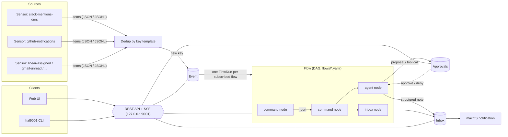

# hal9001

A local macOS daemon that watches Slack, GitHub, Linear and Gmail, runs each new item through flows you write
(shell-command nodes in any language), and hands the ones that matter to a coding agent (Claude Code, Codex, omp)
under one of three autonomy modes. A web UI on `localhost:9001` shows every event, decision, agent transcript and
approval.

- **Plain code decides.** Sensors and command nodes are processes: JSON on stdin, JSON on stdout. Any language.
- **Agents are constrained.** They run over ACP in `readonly`, `approve` or `auto` mode, and every permission request
  is decided by policy or by you, and recorded.
- **Everything is traceable.** For any outcome you can see the source item, each node's input, output, exit code and
  script, the agent transcript, and what was approved.
- **API first.** The UI and the `hal9001` CLI are clients of one JSON REST API ([`api/openapi.yaml`](api/openapi.yaml)).

The full specification is [REQUIREMENTS.md](REQUIREMENTS.md). Working rules for contributors are in
[AGENTS.md](AGENTS.md).

## Architecture



| Term | Meaning |
|---|---|
| Sensor | Scheduled command that prints items. Defined once in `sensors/`, subscribed to by many flows. |
| Event | One item that passed dedup. Immutable. |
| Flow | DAG of nodes subscribed to sensors (`flows/*.yaml`). One FlowRun per event per flow. |
| Node | `command` (process), `agent` (ACP session) or `inbox` (note for you). Nodes have named output ports. |
| Prompt | Reusable prompt template for agent nodes (`prompts/*.md`). |
| Inbox item / Approval | A note for you; a pending decision from an `approve`-mode agent. The web UI opens on the Inbox, which lists notes and pending approvals together (filters: All, Needs action, Notes) and is where approvals are decided; the Approvals page keeps the history. macOS notifications open `/inbox/<id>` (note) or `/inbox/approval/<id>` (approval) with that item selected, even if it is archived or already decided. |

Authoring details: [docs/flows.md](docs/flows.md).

## Prerequisites

macOS, [mise](https://mise.jdx.dev/), and the tools below. Everything pinned in [`mise.toml`](mise.toml) (Go, Node,
pnpm, golangci-lint, lefthook, gitleaks, and the `claude-agent-acp` and `codex-acp` adapters) is installed by
`mise install`.

```sh
mise install        # pinned toolchain and ACP adapters
mise run setup      # git hooks (lefthook) and web dependencies (pnpm install --frozen-lockfile)
```

| Needed for | What | Notes |
|---|---|---|
| Nodes | `bash`, `jq`, `python3`, `node` | Only the interpreters your sensors and nodes use. `jq` is used by the starter sensors. |
| `slack-mentions-dms` | `SLACK_USER_TOKEN` | User token (`xoxp-...`) from a Slack app installed to your workspace. Scopes: `search:read`, `im:history`, `im:read`, `users:read`. |
| `github-notifications`, `triage-github` | `gh auth login` | The token must read notifications (classic scope `notifications`, or `repo`) and pull requests. |
| `linear-assigned` | `LINEAR_API_KEY` | Linear Settings > Account > Security & access. Read-only is enough. |
| `imap-mail` | `python3`, `IMAP_USER`, `IMAP_PASSWORD` | The default email sensor. Set the values in the sensor's Environment section. For Gmail: enable IMAP in Gmail settings and create an app password (Google account > Security > 2-Step Verification > App passwords). A Workspace admin can disable IMAP or app passwords; the poll then fails with `AUTHENTICATIONFAILED`. Other IMAP servers: also set `IMAP_HOST` (see [docs/flows.md](docs/flows.md#sensors)). Read-only: nothing is marked read. |
| `gmail-unread` | [`gog`](https://github.com/steipete/gogcli) | Alternative to `imap-mail`; needs Google OAuth, which a Workspace admin can block. Install it, then `gog auth add you@example.com`. Set `GOG_ACCOUNT` in `env` when `gog` has several accounts. |
| Claude agents | Claude Code login | Runtime `claude`, adapter `claude-agent-acp` (mise-pinned). |
| Codex agents | Codex login (`~/.codex/auth.json`) | Runtime `codex`, adapter `codex-acp` (mise-pinned). |
| omp agents | `omp` with `~/.omp` credentials | Runtime `omp` runs `omp acp`. Not in `mise.toml` (a Homebrew install). |
| Notifications | `terminal-notifier` (optional) | Falls back to `osascript` when missing. |
| Remote access | Tailscale (optional) | See [docs/auth.md](docs/auth.md#tailscale). |

Credentials go in `~/.hal9001/env` (`KEY=VALUE` per line, injected into every sensor and command node, never shown by
the UI or API, and redacted from stored output). A sensor can also have its own values (for example `LINEAR_API_KEY`
on the Linear sensor): set them in the sensor's Environment section in the UI or with `hal9001 sensors env set`. They
are stored in `env.d/sensors/<id>.env`, reach only that sensor and override a same-named global value. The first run
seeds `env.example` next to it. Every value is secret unless you mark it plain: for a value that is not sensitive (a
login name, a host name) use the Secret toggle in the UI, `--plain` on `env set` / `sensors env set`, or a
`# hal:plain KEY ...` comment line in the file. Plain values are shown by the UI and API and are not redacted from
output.

```sh
cp ~/.hal9001/env.example ~/.hal9001/env && chmod 600 ~/.hal9001/env
$EDITOR ~/.hal9001/env
# or, without exposing the value in the process list or shell history:
printf %s "$LINEAR_API_KEY" | bin/hal9001 env set LINEAR_API_KEY --stdin
# or only for one sensor:
printf %s "$LINEAR_API_KEY" | bin/hal9001 sensors env set linear-assigned LINEAR_API_KEY --stdin
```

The ACP runtimes need extra care (isolated agent homes, adapter paths): see [docs/runtimes.md](docs/runtimes.md).

## Quick start

```sh
mise run build          # builds the web UI, then bin/hal9001 with the UI embedded
bin/hal9001 serve       # run in the foreground; Ctrl-C stops it
```

While developing, use the hot-reload loop instead: `mise run dev`, then open http://localhost:5173. UI edits apply
instantly (Vite HMR); Go, `api/` or `content/` edits rebuild and restart the daemon on 127.0.0.1:9001 (it uses your
normal `~/.hal9001` home; stop any other `hal9001 serve` first). Ctrl-C stops both.

`serve` listens on `127.0.0.1:9001` (fixed; the only override is `HAL9001_DEV_PORT`, for dev builds and tests: see
[macOS app](#macos-app)) and on first run seeds `~/.hal9001` from the starter
content, only when the home is new (no `config.yaml`); deleted starters stay deleted, and `hal9001 starters list` /
`hal9001 starters add [name...]` show or restore them without overwriting (use `--home <dir>` or `HAL9001_HOME` for another directory). Open the UI with `bin/hal9001 open`, or go to
<http://localhost:9001>.

To keep it running (starts at login, restarts on exit) use the [macOS app](#macos-app), which manages the daemon's
LaunchAgent for you, or install a headless service without the app:

```sh
bin/hal9001 service install     # writes ~/Library/LaunchAgents/dev.hal9001.daemon.headless.plist and starts it
bin/hal9001 service status      # installed? loaded (pid, last exit code)? answering?
bin/hal9001 service logs -f     # tail ~/Library/Logs/hal9001/hal9001.log
bin/hal9001 service uninstall   # stops it and removes the plist; your home directory is left alone
bin/hal9001 service install --dry-run   # print the plist only
```

`service install` records the path of the binary you ran, so copy `bin/hal9001` to its permanent location first. Under
launchd the daemon writes its own log to `~/Library/Logs/hal9001/hal9001.log` and copies your login-shell `PATH` for
the processes it spawns (mise shims, `gh` and `jq` resolve inside nodes); both are triggered by `HAL9001_LAUNCHD=1`,
which the plist sets. The command replaces the agent of older versions (`com.hal9001.daemon`, written by the removed
`hal9001 install`). Do not run a headless service next to the app's own: both want port 9001; the app notices and
leaves the daemon to the headless service.

### Demo flow (no credentials)

The seeded `demo` flow is enabled. Its `demo-ticker` sensor emits three sample items per poll (first run fires them);
the flow drops the `noise` one and routes the rest to the inbox by severity:

```sh
bin/hal9001 status --table                 # daemon counters and kill switch
bin/hal9001 inbox list --table             # 2 items: one urgent, one normal
bin/hal9001 events list --sensor demo-ticker --table
bin/hal9001 runs list --table
bin/hal9001 sensors poll demo-ticker       # Run now: same items, deduped, no new events
bin/hal9001 sensors poll demo-ticker --rerun-seen --wait   # replay the seen items into the flow and wait for the runs
bin/hal9001 flows run demo --rerun-seen    # or run the flow itself: polls its sensors, runs only this flow
```

The other starter flows (`triage-slack`, `triage-github`, `linear-triage`, `email-secretary`) are disabled and
`dry_run: true` until you have set their credentials; enable them by editing the YAML or in the UI. In dry-run,
agents are forced read-only and side-effect nodes are skipped.

## Home directory

`~/.hal9001` (override with `--home` / `HAL9001_HOME`). Config files are meant to be versioned in git; the seeded
`.gitignore` excludes `data/`, `env` and `env.d/` (an existing `.gitignore` gets missing lines appended at start).

```
~/.hal9001/
  config.yaml          # concurrency, retention, notifications, allowed_hosts/logins, runtimes, auth
  env                  # KEY=VALUE secrets injected into every node (not in git)
  env.d/sensors/<id>.env  # per-sensor KEY=VALUE secrets (mode 0600, not in git); override env for that sensor
  env.example          # seeded template for env
  sensors/*.yaml       # one file per sensor
  flows/*.yaml         # one file per flow
  prompts/*.md         # agent prompt templates (YAML frontmatter + body)
  data/hal.db          # SQLite: events, runs, transcripts, inbox, approvals, flow versions, auth events
  data/blobs/          # large stdout/stderr/transcripts, content-addressed
  data/state/<flow>/<node>/   # persistent scratch dir of a node ($HAL_STATE_DIR); sensors use data/state/_sensors/<id>/
  data/worktrees/<id>/ # git worktrees for agent nodes with cwd mode worktree
  data/runtimes/       # isolated agent homes (codex-home, omp-home)
```

Files are hot-reloaded. A save from the UI or API that is based on a stale copy is rejected with a conflict (`409`).
`config.yaml` keys and defaults:

| Key | Default | Meaning |
|---|---|---|
| `max_agent_runs` | 2 | Global agent concurrency. Excess runs wait as `queued`. |
| `max_command_runs` | 8 | Command-node pool size. |
| `retention_days` | 30 | Nightly prune of runs, events, blobs and worktrees (keeps anything tied to a starred inbox item or pending approval). |
| `dedup_retention_days` | 180 | Dedup keys are kept longer so old items do not re-fire. |
| `notify_min_priority` | `normal` | Inbox items at or above this raise a macOS notification (`low`, `normal`, `high`, `urgent`). Every new approval notifies. |
| `HAL9001_UI_URL` (env, not config) | `http://localhost:9001` | Origin of notification deep links. `mise run dev` sets it to the Vite server, `http://localhost:5173`. |
| `approval_timeout` | `1h` | Default wait for a `per_tool` approval before the run fails (`approval_timeout`). Agent nodes can override it. |
| `session_ttl` | `7d` | Sliding lifetime of a login session. |
| `allowed_hosts` | `[]` | Extra `Host` values the server accepts (your Tailscale hostname). |
| `allowed_logins` | `[]` | Logins accepted by `tailscale-identity`; empty means the login that owns this Mac. |
| `runtimes` | see [docs/runtimes.md](docs/runtimes.md) | ACP agent commands. |
| `auth` | see [docs/auth.md](docs/auth.md) | PAM-style stacks per service. |

`hal9001 validate` checks sensors, flows, prompts and config offline (exit code non-zero on errors; `--json` for
machine-readable diagnostics).

## CLI reference

`hal9001 --help`:

```
usage: hal9001 <command> [flags]

  serve       run the daemon in the foreground
  service     run the daemon without the macOS app: a headless launchd LaunchAgent
  open        open the web UI in the browser
  validate    check sensors, flows, prompts and config offline
  version     print the version
  auth        authentication helpers
  tailscale   Tailscale exposure
  status      daemon counters and kill switch state
  sensors     list, inspect and poll sensors
  events      list, inject and replay events
  flows       list, validate and test flows
  runs        list and inspect flow runs
  node-runs   inspect node runs
  agent-runs  list and inspect agent runs and transcripts
  approvals   list, approve and deny approvals
  inbox       list items; mark read, starred, archived; clear in bulk
  queue       list the run queue; remove runs from it
  killswitch  pause and resume the daemon
  runtimes    list and probe ACP runtimes
  settings    show settings
  env         list, set and unset env variables

API commands print JSON; add --table for a human-readable view.
Global API flags: --url (env HAL9001_URL, default http://127.0.0.1:9001), --session-cookie (env HAL9001_SESSION_COOKIE), --table.
```

Every command accepts `--help`. Errors from the API are printed as the `application/problem+json` document on stderr
(a one-line summary with `--table`) and the exit code is 1; usage mistakes exit 2.

**Local commands** (do not talk to the daemon; take `--home`, env `HAL9001_HOME`, default `~/.hal9001`):

| Command | Flags | Purpose |
|---|---|---|
| `serve` | `--home`, `--web-dir` (serve the UI from a directory instead of the embedded one; env `HAL9001_WEB_DIR`) | Run the daemon in the foreground. |
| `service install` | `--home`, `--dry-run` | Install and start the headless LaunchAgent (label `dev.hal9001.daemon.headless`); replaces the older `com.hal9001.daemon`. |
| `service uninstall` | | Stop and remove the headless LaunchAgent (and the older `com.hal9001.daemon`). |
| `service status` | | Installed? Loaded (state, pid, last exit code)? Answering on `HAL9001_URL`? Where are the logs? |
| `service logs` | `-n` (lines, default 50), `-f` (follow) | Print the log the daemon writes under launchd. |
| `open [path]` | `--home` | Open the UI (or a UI path) in the browser. |
| `validate` | `--home`, `--json` | Lint sensors, flows, prompts and config. |
| `version` | `--home` | Print the version. |
| `auth set-password` | `--home`, `--stdin` | Set the password for the `password` auth module (prompts without echo; `--stdin` reads the first line of stdin). |

**API commands** (flags `--url`, `--session-cookie`, `--table` on all of them):

| Command | Arguments and flags |
|---|---|
| `status` | Daemon counters and kill switch state. |
| `queue list` | Runs waiting for a slot, in claim order, with what each waits for (`flow_slot`, `agent_slot`, `command_slot`, `kill_switch`). |
| `queue remove <run-id>` | Remove one run from the queue: it ends `cancelled` and stays in history. 409 when the run already runs a node. |
| `queue clear` | Remove every queued run. `--flow <id>` limits it to one flow, `--yes` skips the confirmation asked on a terminal. |
| `tailscale status` | Tailscale CLI reachability, this Mac's tailnet hostname and owner, whether serve is configured, whether the hostname is in `allowed_hosts`. |
| `sensors list` / `sensors get <id>` | |
| `sensors poll <id>` | Run now: poll the sensor at once (rejected while the kill switch is engaged; works on a paused or manual-only sensor, and never baselines). `--rerun-seen` also replays items already seen into each target flow, `--flow <id>` (repeatable) limits new events and re-runs to those flows, `--wait`/`--timeout 10m` wait for the created flow runs and print their final status as `flow_runs`. Prints the sensor run with `new_events`, `rerun_events`, `flow_run_ids`. |
| `sensors reset <id>` | Forget the sensor's dedup keys and `HAL_LAST_SUCCESS_AT` so its next run treats every item as new (history is kept; works on a paused sensor; 409 while it polls). `--run` runs it right after (`--flow <id>` limits that run), `--yes` skips the confirmation asked on a terminal. |
| `sensors pause <id>` / `sensors resume <id>` | Stop or restart the scheduled polls of one sensor. Persisted across restarts; Run now and `events inject` still work while paused. |
| `sensors env list <id>` | Key names of the sensor's own env, and whether each overrides a global key. Values are never shown. |
| `sensors env set <id> <KEY> [value]` | `--stdin` reads the value from stdin. Takes effect on the next poll. |
| `sensors env unset <id> <KEY>` | |
| `sensors validate [file.yaml\|-]` | Validate sensor YAML without saving. |
| `assist create --runtime <name>` | Start an AI-assisted authoring session: `--sensor <id>` (edit an existing sensor), `--model`, `--yaml file\|-`. See [docs/assist.md](docs/assist.md). |
| `assist list` / `assist get <session>` | `--target-kind`, `--target-id`; `get` includes the conversation. |
| `assist send <session> <text...>` | `--yaml file\|-` replaces the draft first. Starts one agent turn. |
| `assist test [<session>]` / `assist draft [<session>]` | Run the draft like Poll now (redacted JSON result) / print the draft with its diagnostics. The session defaults to `HAL9001_ASSIST_SESSION`. |
| `assist cancel [<session>]` / `assist close <session>` | Cancel the running turn / end the session and delete its draft directory. |
| `events list` | `--sensor`, `--flow`, `--kind`, `--status`, `--decision`, `--q`, `--since`, `--until` (RFC 3339), `--limit`, `--cursor` |
| `events get <id>` | The event with its fan-out of flow runs. |
| `events inject <sensor-id>` | `--file item.json` (default: JSON on stdin). Goes through dedup and fan-out like a polled item. |
| `events replay <event-id>` | `--flow <flow-id>` (required), `--dry-run=true\|false` (omit to keep the flow's setting). |
| `flows list` / `flows get <id>` | |
| `flows validate [file.yaml\|-]` | Validate flow YAML without saving. |
| `flows run <id>` | Run now: poll every sensor the flow subscribes to and run only this flow on what they return (also a flow with `enabled: false`). `--rerun-seen` replays seen items into it, `--wait`/`--timeout 10m` wait for the created runs and print their final status. |
| `flows test-node <flow-id> <node-id>` | Input from one of `--event <id>`, `--node-run <id>[:<index>]`, `--json <value>`, or stdin. `--dry-run`, `--wait 60s`. |
| `runs list` | `--flow`, `--event`, `--kind` (`live`, `replay`, `test`), `--status`, `--replay-of`, `--since`, `--until`, `--limit`, `--cursor` |
| `runs get <id>` | `--wait` (block until finished or awaiting approval), `--timeout 10m` |
| `node-runs get <id>` | `--wait`, `--timeout 10m` |
| `agent-runs list` | `--flow-run`, `--node-run`, `--runtime`, `--status`, `--limit`, `--cursor` |
| `agent-runs get <id>` | |
| `agent-runs events <id>` | `--after-seq N`, `--limit N`, `--kind K` |
| `approvals list` | `--status` (`pending`, `approved`, `denied`, `expired`), `--type` (`proposal`, `tool_call`, `request`), `--flow-run`, `--agent-run`, `--limit`, `--cursor` |
| `approvals get <id>` | |
| `approvals approve <id>` | `--comment text` (passed to the agent) |
| `approvals deny <id>` | `--comment text`, `--cancel-run` (tool-call approvals: end the run instead of letting the agent continue) |
| `inbox list` | `--unread`, `--starred`, `--archived`, `--dry-run`, `--flow`, `--priority`, `--q`, `--sort`, `--limit`, `--cursor` |
| `inbox get <id>` | |
| `inbox read <id>` / `star <id>` / `archive <id>` | `--unread` / `--off` / `--undo` reverse the action. |
| `inbox archive` / `read` / `delete` (bulk) | Select with `<id>`, `--ids a,b`, `--all` or filter flags `--state read\|unread`, `--starred`, `--archived`, `--priority`, `--max-priority`, `--flow`, `--q`, `--older-than 7d`, `--dry-run-flows`. Starred items are kept unless `--include-starred`. `--preview` only counts; filter-based runs ask for confirmation on a terminal (`--yes` skips it). `archive --undo` unarchives; `read --unread` marks unread. `delete` is permanent and only removes archived items (others are skipped and counted). |
| `killswitch get` / `resume` | |
| `killswitch pause` | `--kill` (also terminate running nodes), `--reason text` |
| `runtimes list` | |
| `runtimes probe <name>` | Start the runtime and report what it advertises. |
| `settings get` | `config.yaml` as JSON, secrets redacted. |
| `env list` | Variable names only. |
| `env set <KEY> [value]` | Without a value, or with `--stdin`, the value is read from stdin. |
| `env unset <KEY>` | |

There is no CLI command to create flows or sensors: they are files in the home directory (hot-reloaded), or edited in
the UI, or written through the API (see [docs/api.md](docs/api.md)). The CLI authenticates like any client: with the
default auth config local requests need nothing; otherwise pass a session cookie obtained from
`POST /api/auth/{service}/begin` ([docs/auth.md](docs/auth.md#logging-in-from-scripts)).

## macOS app

`cmd/hal9001-app` is the HAL9001 menubar app, a client of the daemon's REST API that also owns the daemon's LaunchAgent. It shows the HAL 9000 eye (dimmed when the daemon is down, throbbing while flows run), the inbox count (unread notes plus pending approvals, hidden at 0), a status line (Running or Stopped, the version, the home directory) and quick links to the Inbox, Approvals, enabled flows, sensors and Settings. It refreshes from `GET /api/stream` and polls every 10 s as a fallback. The service menu entries:

- **Service**: Start, Stop, Restart the daemon. Start and Stop register and unregister the LaunchAgent bundled in the app (`Contents/Library/LaunchAgents/dev.hal9001.daemon.plist`, started at login and kept alive) through `SMAppService`; Restart is `launchctl kickstart -k gui/$UID/dev.hal9001.daemon`. The first time the app runs it registers the service. A service you stopped stays stopped.
- **Open logs**: `~/Library/Logs/hal9001/hal9001.log` (the app's own log is `app.log` next to it).
- **Launch at login**: the app itself, as a login item (`SMAppService.mainApp`).
- **Install command-line tool**: symlinks `~/.local/bin/hal9001` to the `hal9001` inside the app, so it updates with the app, and says so when `~/.local/bin` is not on your login-shell `PATH`.

Older installs: the app notices the agents of previous versions (`com.hal9001.daemon` from the removed `hal9001 install`, `dev.hal9001.menubar` from the removed `hal9001-menubar install`) and offers **Remove older launch agents…**; it does not start its own service while they hold port 9001. If a headless service (`hal9001 service install`) is installed, the app does not register its own and the menu says to run `hal9001 service uninstall` first.

**Notifications.** When the app runs from `/Applications` or `~/Applications` it asks for notification permission once (at first launch) and, while permission is granted, opens its stream connection as the daemon's notification sink (`X-Hal9001-Notifier: app`, `notification.created`), so the daemon stops running `terminal-notifier` and the app shows what it routes to channel `app`: title is the flow, plus subtitle and body, grouped per flow, with a sound for `high` and `urgent`. Notes get Open, Mark read, Archive; proposals, tool calls and requests get Approve, Deny, Approve with comment… and Deny with comment…; a request with editable fields gets Approve as-is, Deny, Open to edit. Clicking a notification opens its page. The buttons call the REST API; a failure is reported as a small notification. If you deny permission or switch every notification style off, the menu shows **Notifications are off — Open Settings** and the app stops being the sink, so `terminal-notifier` takes over again. The first time an urgent notification arrives as a banner, the menu suggests the Alerts style (banners disappear by themselves). An ad-hoc signed app cannot post time-sensitive notifications, so Focus modes can still hold them back. Outside a bundle (`mise run app:run`) the app never registers as a sink.

```sh
mise run app          # builds bin/HAL9001.app (release id dev.hal9001) and bin/HAL9001 Dev.app (dev.hal9001.dev), signed ad hoc,
                      # and installs the dev copy to ~/Applications/HAL9001 Dev.app
mise run app:run      # (alias: menubar) run from source, outside a bundle: menu and API client only, no service management
```

See [docs/macos-app.md](docs/macos-app.md) for the manual test checklist.

**Installing:** open `HAL9001-<version>.dmg` and drag HAL9001 onto Applications. The app is signed ad hoc, so for a copy downloaded from the internet Gatekeeper blocks the first launch: right-click the app, choose Open, then Open again (or run `xattr -dr com.apple.quarantine /Applications/HAL9001.app`).

The bundle holds the app (`Contents/MacOS/HAL9001`, cgo: `fyne.io/systray` plus an Objective-C bridge for `SMAppService` and alerts), the daemon and CLI built with the UI embedded (`Contents/Resources/hal9001`), `AppIcon.icns` (rendered from the menubar eye by `cmd/hal9001-app-pack`) and the LaunchAgent plist. It needs macOS 13 or later. Signing is ad hoc (`codesign -s -`, nested binary first, then the bundle); never use a self-signed certificate. Notifications only work when the app lives in `/Applications` or `~/Applications`, which is why the dev copy is installed there.

**Dev builds** never touch the real app's state: the dev bundle id gives its own LaunchAgent label (`dev.hal9001.dev.daemon`), log directory (`~/Library/Logs/hal9001-dev/`), notification permission, login item and CLI link name (`hal9001-dev`). Two build-time variables pin the dev build's service to another daemon home and port, for running next to your real daemon: `HAL9001_APP_DEV_HOME=/tmp/hal-dev HAL9001_APP_DEV_PORT=19001 mise run app` (the port reaches the daemon as `HAL9001_DEV_PORT`; `HAL9001_APP_INSTALL_DIR` changes where the dev copy is installed, `none` skips it). After you rebuild, the app registers the service again on its next launch; launchd can refuse to start a freshly replaced binary for a minute or two (exit 78), in which case wait and use Service > Stop service, then Start service.

Set `--url` / `HAL9001_URL` for the API (default `http://127.0.0.1:9001`) and `HAL9001_UI_URL` for the pages it opens (for example `http://localhost:5173` under `mise run dev`).

## Development

Rules for humans and agents are in [AGENTS.md](AGENTS.md). In short:

- All tools run through mise: `mise exec -- <tool>` or `mise run <task>`. First time in a clone or worktree:
  `mise run setup`.
- Commit early, one logical change per commit. Never bypass hooks. Pre-commit first auto-fixes and re-stages your staged
  files (gofmt/goimports, prettier, and `web/src/api/schema.d.ts` regenerated from `api/openapi.yaml`), so formatting
  never fails a commit. It then runs gitleaks, `go mod tidy -diff`, golangci-lint, `go test -short`, and for `web/`:
  oxlint, tsc, vitest. Pre-push runs `mise run race`, `RACE=1 mise run e2e` and the full web check. When a hook fails,
  assume your code is wrong first.
- Parallel work uses one git worktree and branch per agent; the coordinator merges. Do not commit to `main` directly
  or touch another worktree.
- API first: `api/openapi.yaml` is the contract and changes in the same commit as the handler. After editing it run
  `pnpm --dir web gen:api` to regenerate the UI types.

| Task | Command |
|---|---|
| Build UI and binary | `mise run build` (outputs `bin/hal9001`) |
| Build UI, binary and the macOS app | `mise run build:all` (outputs `bin/hal9001`, `bin/HAL9001.app` and `bin/HAL9001 Dev.app`); `mise run app` builds just the app bundles |
| Build the DMG installer | `mise run dmg` (after `mise run app`; outputs `bin/HAL9001-<version>.dmg`: the app, an `Applications` link and a background; the window layout is written by pinned `dmgbuild` via `uv`, no Finder or GUI session needed); `mise run dmg:check` mounts it read-only and verifies the contents |
| App then DMG | `mise run release` |
| Hot-reload dev loop (UI on :5173, daemon restarts on Go changes) | `mise run dev` |
| Everything the hooks run, on the whole tree | `mise run check` (static checks, `race`, sharded `e2e` and the web check, in parallel) |
| Race detector on all packages but e2e | `mise run race` |
| Throwaway daemon with a fake agent runtime (free port, temp home) | `mise run sandbox -- [--port N] [--script file.json] [--web-dir dir] [--keep]` |
| UI dev server (proxies `/api` to `127.0.0.1:9001`) | `mise exec -- pnpm --dir web dev` |
| Web checks only | `mise exec -- pnpm --dir web check` |

## Testing

- **Unit and API tests:** `mise exec -- go test -short ./...` (fast; this is what pre-commit runs) and
  `mise run race` (pre-push). Tests assert behavior a user or API client would notice, through the
  real router (`httptest`) or the CLI, not through the UI. Slow suites skip under `-short`.
- **Agent behavior** is tested against the scripted fake ACP agent ([`cmd/fake-acp-agent`](cmd/fake-acp-agent/README.md)),
  never a real model, so modes, policy, approvals, resume, timeouts and cancellation are deterministic.
- **End to end:** `mise run e2e` (`E2E_SHARDS=4` parallel shards of one test binary; `RACE=1` adds `-race`, as pre-push does) starts the real daemon in-process and drives the scenarios of
  [REQUIREMENTS.md §12](REQUIREMENTS.md) through the REST API and CLI only, with the fake agent. Each can be reproduced by
  hand with `curl` or the CLI ([docs/api.md](docs/api.md) has a walkthrough). The suite skips under `-short`.
- **Live:** `HAL9001_LIVE=1 mise exec -- go test -count=1 ./e2e/live/` runs the real claude/codex/omp runtimes and the real
  GitHub sensor (skipped without the env var); see [docs/live-smoke.md](docs/live-smoke.md).
- **Real adapters:** `hal9001 runtimes probe <name>` and `cmd/acp-probe` check a runtime by hand
  ([docs/runtimes.md](docs/runtimes.md)).

Only one process can hold port 9001. Tests start in-process daemons on `127.0.0.1:0`, and use a temporary home, never
`~/.hal9001`.

## More documentation

| Document | Contents |
|---|---|
| [REQUIREMENTS.md](REQUIREMENTS.md) | Full specification and acceptance scenarios. |
| [docs/flows.md](docs/flows.md) | Writing sensors, flows and prompts: the node contract, routing, templates, agent nodes, dry-run, replay, test-node. |
| [docs/auth.md](docs/auth.md) | Auth stacks, modules, Tailscale setup, threat notes. |
| [docs/runtimes.md](docs/runtimes.md) | Configuring and probing ACP runtimes. |
| [docs/acp-gate.md](docs/acp-gate.md) | Measured behavior of the real adapters (Claude, Codex, omp). |
| [docs/assist.md](docs/assist.md) | AI-assisted sensor authoring: draft, permission policy, secret model, lifecycle. |
| [docs/api.md](docs/api.md) | REST API guide: auth, pagination, long-polling, SSE, errors, curl walkthrough. |
| [docs/live-smoke.md](docs/live-smoke.md) | Live smoke tests against real runtimes and services. |
| [cmd/fake-acp-agent/README.md](cmd/fake-acp-agent/README.md) | The scripted ACP agent used by tests. |
| [web/README.md](web/README.md) | UI layout and dev commands. |

Sensors, flows, tools and prompts are named by their file; rename them from the UI or `hal9001 <kind> rename <old> <new>` (see docs/flows.md).
