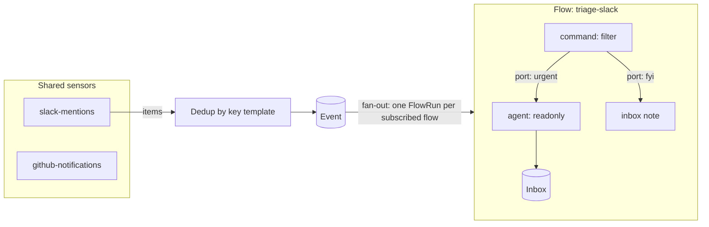
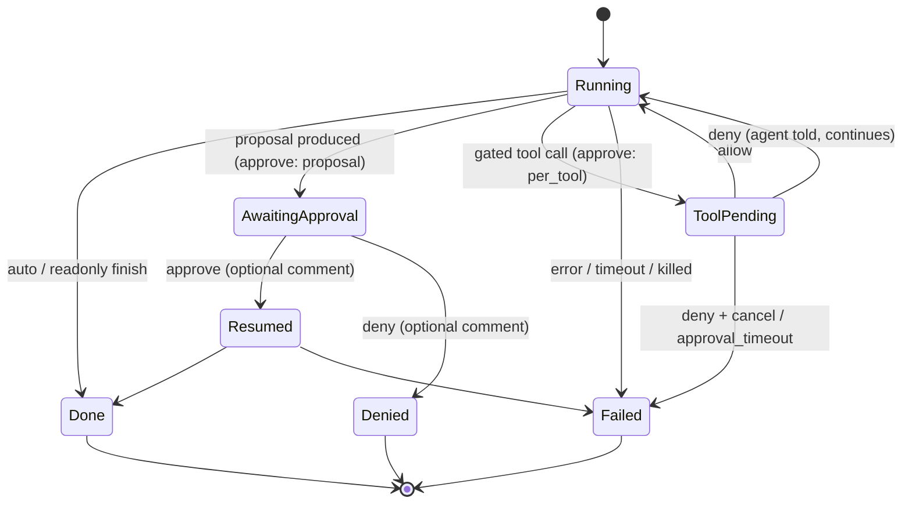
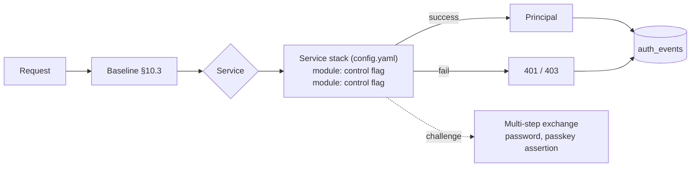

# hal9001: requirements

A local macOS daemon that polls Slack, GitHub, Linear, and Gmail, runs events through user-built flows of shell-command nodes, and hands selected events to coding agents (Claude Code, Codex, omp) under one of three autonomy modes. A localhost web UI provides a visual flow editor (n8n style) and full traceability of every event, decision, and agent run.

## 1. Goals and non-goals

Goals
- One place that watches the systems I bounce between and triages for me.
- Plain code (any language, via stdin/stdout) decides what reaches an agent; agents are invoked with selectable, pre-canned prompts.
- Deep traceability: for any outcome I can see the source item, every node's exact input/output/command/exit code, the agent transcript, and what was approved.
- Build and debug flows visually: canvas, per-node test runs, replay, dry-run.

Non-goals (v1)
- Webhooks, Slack Socket Mode, or any inbound public endpoint. Polling only.
- Multi-user, binding beyond loopback (remote access is via `tailscale serve` only, §10.5), token/OIDC auth modules.
- Embedded scripting VM. Nodes are processes.
- Join/merge nodes, loops, sub-flows.
- Direct LLM API calls (agents only, over ACP).
- ACP client `fs`/`terminal` capabilities (agents use their own tools).
- Per-flow daily budgets (concurrency + timeouts + kill switch only).
- Keychain secret management.

## 2. Concepts



| Term | Meaning |
|---|---|
| Sensor | Shared, scheduled command that prints items (JSON array or JSONL). Defined once, subscribed to by many flows. |
| Item / Event | One item from a sensor that passes dedup. Immutable, stored. |
| Flow | DAG of nodes subscribed to 1+ sensors. YAML file. |
| FlowRun | One execution of one flow for one event (or replay / manual test). |
| Node | `command`, `agent`, `inbox`, `approval` ("Request approval": parks the node on a pending `request` approval until approved, denied or timed out; ports `approved`/`denied`; docs/flows.md; any other node can ask the same way before it runs with `requires_approval`), or `transform` (plain-language steps compiled to jq, for people who do not write code). Has named output ports. |
| NodeRun | One execution of a node within a FlowRun. |
| AgentRun | Agent CLI session(s) behind an agent NodeRun, incl. full transcript. |
| Prompt | Reusable prompt template file selected by agent nodes. |
| Inbox item | Structured note for me (from read-only agents or `inbox` nodes). |
| Approval | A decision hal asks me for, with one shape: title, required description, details (command, diff, fields), priority, origin and the conversation it was requested in. Raised only by `RaiseApproval`, whatever asked: an approve-mode agent's proposal or gated tool call, an agent's `request_approval`, a node gate, a Request approval node, an MCP client. Approve, Deny (with optional additional steering) or Deny + stop (tool calls). `max_steers_per_run` (default 3) bounds steered denials per conversation. |
| Remote MCP server | An MCP server hal connects to as a client (`mcp_servers` in `config.yaml`), with OAuth or an API key kept in `data/mcp/`. Sensors and the chat assistant call its tools (docs/mcp-servers.md). Not the MCP servers an agent node passes through. |

## 3. Storage layout

Home dir defaults to `~/.hal9001` (override `--home`). Config files are meant to be git-versioned; runtime data is not.

```
~/.hal9001/
  config.yaml          # port, concurrency, retention, defaults
  env                  # KEY=VALUE, injected into every node (SLACK_USER_TOKEN, LINEAR_API_KEY, ...)
  env.d/sensors/<id>.env  # per-sensor KEY=VALUE secrets (0600, git-ignored); overlay `env` for that sensor only
  sensors/*.yaml
  flows/*.yaml
  prompts/*.md
  data/hal.db          # SQLite (traces, events, inbox, approvals, flow versions)
  data/blobs/          # large stdout/stderr/transcripts, content-addressed
  data/state/<node>/   # persistent per-sensor/per-node scratch dir ($HAL_STATE_DIR)
  data/worktrees/<run>/
  data/assist/<session>/  # AI-assisted authoring: the draft sensor.yaml and the agent's instructions (§5.1)
  data/mcp/<name>.secrets.json  # remote MCP server credentials and OAuth tokens (0600, never returned by the API); <name>.state.json holds the tool cache (no secrets)
```

- Config files are hot-reloaded on change (fsnotify). The UI writes YAML; if the file changed on disk since the UI loaded it (hash mismatch), the save is rejected with a conflict.
- Every FlowRun records the content hash of the flow YAML; each distinct version is snapshotted in `flow_versions` so traces always show the exact flow that ran.

## 4. Node execution contract (applies to sensors and command nodes)

Process model:
- `lang: bash | python | node | jq | exec`. Inline `script` is written to a temp file and run with the interpreter (`bash`, `python3`, `node`, `jq -c -f`). `exec` runs `command: [argv...]` directly.
- stdin: the node's input payload (JSON). For the first node this is the sensor item.
- stdout: output, parsed as one JSON value or JSONL.
- stderr: captured as logs, shown in trace.
- Working dir: node's `$HAL_STATE_DIR` unless `cwd` set.

Result semantics:

| stdout | exit | Meaning |
|---|---|---|
| empty | 0 | **Drop**: branch ends, recorded as decision `dropped` (so `jq 'select(...)'` is a filter). |
| one JSON value | 0 | Emit on port `out` (or `_port` if present). |
| JSONL, N lines | 0 | Emit N payloads (split/fan-out), each routed by its own `_port`. |
| any | ≠0 | Error. Routed to implicit `error` port if wired, else branch fails. |
| any | killed by timeout | Error `timeout`. |

- Reserved keys in an output object: `_port` (string, routing), `_reason` (string, shown as decision reason in the trace). Both stripped before passing downstream.
- A `_port` not declared on the node is an error.

Environment injected into every process:

| Var | Value |
|---|---|
| everything in `env` file | |
| `HAL_EVENT_FILE` | path to original event JSON |
| `HAL_RUN_ID`, `HAL_EVENT_ID`, `HAL_FLOW`, `HAL_NODE` | ids |
| `HAL_STATE_DIR` | persistent dir for this sensor/node |
| `HAL_DRY_RUN` | `1` in dry-run |
| `HAL_LAST_SUCCESS_AT` | sensors only: RFC3339 of last successful poll (for incremental fetch) |

PATH: the daemon runs under launchd, which has a minimal PATH. When launchd starts it (the agent plists set `HAL9001_LAUNCHD=1`), `hal9001 serve` captures the user's login-shell `PATH` and hands it to the processes it spawns, so mise shims, `gh`, `jq`, etc. resolve.

## 5. Sensors

```yaml
# sensors/github-notifications.yaml
id: github-notifications
interval: 2m              # or cron: "*/5 9-18 * * 1-5"; neither = manual-only (never scheduled)
lang: bash
script: |
  gh api notifications --paginate -q '.[]' 
key: "{{.id}}:{{.updated_at}}"   # Go text/template over the item; configurable re-trigger
first_run: baseline       # baseline = mark all seen without firing; fire = emit everything
timeout: 60s
```

- Output: JSON array or JSONL of items. Each item gets a dedup key from the `key` template; unseen keys become Events.
- Every poll is recorded (SensorRun: start, duration, item count, new count, stdout/stderr, exit code). Failures are shown on the sensor page and don't advance `HAL_LAST_SUCCESS_AT`.
- Remote MCP servers: a sensor may list `mcp_servers: [<name>]` (names from `config.yaml` `mcp_servers`; unknown or repeated names are validation errors). The poll's environment then has `HAL9001_URL` and `HAL9001_RUN_TOKEN`, a run-scoped token for exactly those servers, and the script calls a tool with `hal9001 mcp call <server> <tool> --args '<json>'` (stdout: the tool's structured content, else `{"text": ...}`; a tool error exits 1). The script never sees the server's credentials. No approval at poll time; every call is recorded on the SensorRun as `mcp_calls`. `hal9001 mcp` without `call` is still the stdio bridge to hal's own MCP server. See docs/mcp-servers.md.
- Manual "Run now" (`POST /api/sensors/{id}/poll`, optional body `{rerun_seen, flows}`). It is an explicit user action: it works while the sensor is paused or has no subscriber, is rejected (423) under the kill switch, and never applies `first_run: baseline` (only the scheduler's first poll baselines). New items become events and fan out as usual; with `rerun_seen` items whose key was already seen are replayed (`kind: replay`, current flow version) into each target flow, where the replayed event is the key's most recent event or, if retention pruned it, a new event stored for that manual run; the dedup state does not change. `flows` restricts fan-out and re-runs to the listed flows (which may be disabled). The response is the SensorRun plus `new_events`, `rerun_events`, `flow_run_ids`. Sensors pause with the kill switch.
- Run a flow now (`POST /api/flows/{id}/run`, `{rerun_seen}`): polls every sensor the flow subscribes to, in parallel, with that flow as the only target; also for a flow with `enabled: false` (explicit user action); 422 when it subscribes to nothing.
- A sensor with neither `interval` nor `cron` is manual-only: valid, never scheduled, `next_poll_at` null, status `manual`.
- Reset (`POST /api/sensors/{id}/reset`, `{run, rerun_flows}`): clears the sensor's dedup keys and `last_success_at` (history is kept), records who and when, so the next poll is that of a new sensor (the scheduler applies `first_run` again; `run: true` runs it at once, without baseline). 409 while the sensor is polling; 423 only with `run: true`.
- Starter sensors shipped in `sensors/` (editable templates):

| Sensor | Mechanism | Credential | Key |
|---|---|---|---|
| slack-mentions-dms | curl `search.messages` (mentions) + `conversations.list/history` (IMs) | `SLACK_USER_TOKEN` (xoxp; `search:read`, `im:history`, `im:read`, `users:read`) | `{{.channel}}:{{.ts}}` |
| github-notifications | `gh api notifications` (incl. review requests) | existing `gh` auth | `{{.id}}:{{.updated_at}}` |
| linear-assigned | curl GraphQL: assigned issues + comments updated since `HAL_LAST_SUCCESS_AT` | `LINEAR_API_KEY` | `{{.id}}:{{.updatedAt}}` |
| imap-mail | python3 `imaplib`: `EXAMINE` + `UID SEARCH` + `BODY.PEEK[]` (read-only; Gmail extensions when advertised) | per-sensor env `IMAP_USER`, `IMAP_PASSWORD` (Gmail app password); optional `IMAP_HOST`, `IMAP_PORT`, `IMAP_TLS`, `IMAP_MAILBOX`, `IMAP_SEARCH`, `IMAP_MAX` | `{{.id}}` (`X-GM-MSGID`, else `UIDVALIDITY:UID`) |
| gmail-unread | Gmail CLI query `is:unread in:inbox` (alternative; needs Google OAuth) | CLI's own OAuth | `{{.id}}` |

Pause: a sensor can be paused on its own (`POST /api/sensors/{id}/pause`, `hal9001 sensors pause`). The state is stored in the database (not the YAML), survives restarts and records who and when. The scheduler skips a paused sensor and `next_poll_at` is null; "Poll now" and event injection still work, since they are explicit user actions.

Per-sensor env: a sensor's own secrets live in `env.d/sensors/<id>.env`, never in its YAML. A poll gets `env` overlaid with the sensor's values (the sensor wins). Secret values are write-only (API and UI list names only). A key can be marked plain (not secret) with a `# hal:plain KEY ...` comment line in the env file (UI Secret toggle, `--plain` in the CLI, `secret: false` in the API); a plain value is returned by the env listings and is not redacted. Default is secret.

Email: the default is `imap-mail` because Google OAuth can be blocked by Workspace admins. Gmail CLI: neither `gog` nor `gws` is installed yet. The alternative `gmail-unread` uses `gog`; its template is verified once installed (see §13). The `email-secretary` flow subscribes to `imap-mail`.

### 5.1 AI-assisted sensor authoring

"Ask AI" in the header of every page opens one global chat drawer (it stays open across page changes; `New chat`/`/new`, a History list; each turn carries the current page's compact context as untrusted data; the agent can open pages with `navigate_ui` and hand over to a draft session with `start_draft`; `general` sessions have no draft). The Sensors, Flows and Tools pages keep "Create with AI" as a shortcut into that drawer for a sensor, flow or tool draft. The user talks to an agent running on one of the configured ACP runtimes (`runtimes` in `config.yaml`); the agent edits a **draft** of the sensor, which shows up live in the sensor editor; the user tests it and saves with the normal Save button. Full description: `docs/assist.md`.

- **Draft, not file.** The agent never writes a real sensor file. It edits `data/assist/<session>/sensor.yaml`; only Save (the ordinary sensor create/update endpoints, with `expected_hash`) persists a sensor. The draft is validated like a sensor file after every change (for a new sensor the id need not exist yet; a changed id of an existing sensor is flagged) and the latest copy, with its diagnostics and who wrote it, is part of the session.
- **No secrets for the agent.** The agent's environment contains no value from `env` or `env.d`; it is told the variable names only (global plus the target sensor's). It tests the draft through the daemon (`POST /api/assist/sessions/{id}/test`, `hal9001 assist test`), which runs it like Poll now with the global env overlaid by the target sensor's values, redacts the output (§9) and records nothing: no sensor run, events or dedup keys.
- **Permissions per turn** (the gated policy of §7.2): read-class calls are allowed (not on protected files such as `env`, `env.d`, `config.yaml`, the database); edits inside the session's draft directory are allowed; `hal9001 assist draft` and `hal9001 sensors validate sensor.yaml` are allowed; `hal9001 assist test` is allowed only for a script the user has tested or approved (a test runs the script with real credentials; a changed script is a `tool_call` approval whose description shows the script and a diff, and the daemon refuses an agent test of an unapproved script); everything else is a `tool_call` approval, decided inline in the chat on the same approval card as the Inbox (Approve / Deny with optional additional steering / Deny + stop). Codex cannot continue after a denial, so a denial ends its turn.
- **Traceability.** Every turn is an agent run (mode `approve`, style `per_tool`, policy `gated`, phase `execute`, `assist_session_id` set, no node run) with transcript, permission requests and approvals, visible on the Agent run page.
- **Lifecycle.** One turn at a time; the agent process is kept alive between turns and suspended after 15 minutes idle; the next message resumes it with `session/load` (fallback: a new session with a recap, recorded on the run). The kill switch does not apply to assist: messages, draft tests (flow tests included) and running turns are unaffected by it, including "pause and kill running". Sessions and drafts are pruned by retention; closing a session deletes its draft directory.
- **API.** `POST/GET /api/assist/sessions`, `GET/DELETE .../{id}`, `POST .../{id}/messages`, `PUT .../{id}/draft`, `POST .../{id}/test`, `POST .../{id}/cancel`; SSE `assist.updated`, `assist.message`, `assist.navigate` and `assist.start_draft` (filter `assist_session_id`); `page_context` on `POST .../messages`.

## 6. Flows

```yaml
# flows/triage-github.yaml
id: triage-github
enabled: true
dry_run: false
subscribe: [github-notifications]
max_concurrent: 2
nodes:
  - id: only-review-requests
    type: command
    lang: jq
    script: 'select(.reason == "review_requested") | . + {_reason: "review requested"}'
    ui: {x: 100, y: 80}

  - id: classify
    type: command
    lang: python
    ports: [small, large]
    script: |
      import json, sys, subprocess
      ev = json.load(sys.stdin)
      # ... call gh to get PR size ...
      ev["_port"] = "small" if additions < 200 else "large"
      print(json.dumps(ev))

  - id: review-small
    type: agent
    runtime: claude          # key in config.yaml `runtimes` (claude | codex | omp | ...)
    mode: approve            # auto | approve | readonly
    approve: proposal        # proposal | per_tool (approve mode only)
    prompt: pr-review        # prompts/pr-review.md
    extra_prompt: "Focus on tests."
    model: sonnet
    cwd: {mode: worktree, repo: "~/code/{{.input.repository.name}}", ref: "origin/main"}
    timeout: 20m

  - id: note-large
    type: inbox
    title: "Large PR needs you: {{.input.subject.title}}"
    priority: high
    summary_md: "{{.input.subject.url}}"

edges:
  - {from: only-review-requests, to: classify}
  - {from: classify, port: small, to: review-small}
  - {from: classify, port: large, to: note-large}
```

Rules
- Graph must be a DAG; validated on load and save (cycles, unknown nodes, undeclared ports, unreachable nodes → error shown in editor).
- Entry nodes = nodes with no incoming edges; each receives the event.
- Fan-out: one output port can feed multiple nodes; they run concurrently.
- Implicit ports on every node: `error`. Agent nodes also have `denied` (approve mode), as does any node with `requires_approval`.
- `requires_approval: true` (every node type but `approval`; optional `approval_timeout`): when the node is reached hal raises a `request` approval ("<flow>: run <node>?", with the node's resolved configuration and input) and parks the node as `awaiting_approval`. Approve runs the node; deny or timeout skips it and emits the input and the decision on port `denied` (an unwired `denied` ends the branch without failing the run; `error` stays for real failures). Dry runs still ask; docs/flows.md.
- `side_effect: true` on command nodes marks them as acting on the world; skipped (recorded as `skipped:dry_run`) in dry-run.
- Templates (`key`, `cwd`, `inbox` fields, prompts) use Go `text/template` with data `{.event, .input, .flow, .run}` (`.input` = node input payload) plus a few helpers (`json`, `default`, `trunc`).

## 7. Agent nodes

### 7.1 Prompts

```markdown
---
name: pr-review
description: Review a PR and leave comments
output: note            # note = structured inbox schema (§7.4); none = free text
---
You are reviewing {{.input.subject.url}}.
...
```

Agent node selects a prompt from the library (dropdown in UI) plus optional `extra_prompt`. The rendered prompt is stored on the AgentRun.

An agent node can instead declare `ports` (`<name>: {description, schema}`) and `emit: one|many`: each port with an outgoing edge becomes a required tool `emit_<port>` on hal's per-run MCP server (only for that run and node, validated against the port schema, allowed in every mode), and hal appends a generated "Outputs" section to the rendered prompt. The validated arguments reach downstream nodes as `agent.output` (with `agent.port`); a turn without a valid emission gets one follow-up, then fails with class `no_output` on the `error` port. A schema-less port that leads only to inbox nodes uses the note schema. With `output: note` hal also offers `submit_output` (note schema), preferred over text parsing. Flow tests drive agent nodes with `simulate_emit`. Details in docs/flows.md ("Outputs and ports").

### 7.2 Modes

All agents are driven over ACP (§7.3). The harness is the ACP client, so every permission request from the agent comes to the harness and is decided by policy or by me, and recorded.



| Mode | Behavior | Output |
|---|---|---|
| `auto` | Agent in its most permissive session mode; the harness allows every permission request (still recorded). | Port `out`; inbox item only if prompt `output: note`. |
| `approve` + `proposal` (default) | Phase 1 runs under the read-only policy, with a prompt suffix: "investigate, then propose a concrete plan; do not change anything". The agent process exits after the proposal, which becomes an Approval plus a notification. Approve resumes the **same session** (`session/load`) under the auto policy, with "Approved. Execute the plan." plus my comment. Deny is recorded and routes to port `denied`; a Deny with additional steering instead resumes the agent to revise and propose again (up to `max_steers_per_run`). | Port `out` after phase 2. |
| `approve` + `per_tool` | One session under a gated policy: read-class tool calls are allowed automatically; every other permission request becomes an Approval showing the tool, its kind, and its input or diff. Approve continues the call. Deny rejects that call and the agent continues, with the user's additional steering text in the denial when given. Deny + stop ends the run. The agent process stays alive while it waits; after `approval_timeout` (default 1h) the request is rejected and the run fails with `approval_timeout`. | Port `out`. |
| `readonly` | Read-only policy. It produces a structured note only with `output: note`; with `output: none` or `ports` it makes none. `emit_<port>` tools are allowed. | Inbox item + macOS notification (note output); port `out` or the declared ports. |

FlowRuns waiting on an approval have status `awaiting_approval`; downstream nodes run after the agent finishes. Proposal approvals never expire and survive daemon restarts. Per-tool approvals die with the agent process: a daemon restart marks them `expired` and the run `interrupted`.

Permission policy (harness side, applied to every `session/request_permission`):

| Policy | Allowed automatically | Everything else |
|---|---|---|
| read-only | ACP tool kinds `read`, `search`, `fetch`, `think`; plus node `allow` rules | rejected, with the reason recorded |
| gated (`per_tool`) | same as read-only | sent to the approval queue |
| auto | all | n/a |

Agents run locked down (docs/acp-lockdown.md): no native shell, file or web tools; they act through hal's MCP server, which approves inside itself (docs/design/agent-access.md). Node `allow: {tools: [<regex on tool title/name>]}` lets an agent call tools of MCP servers declared on the node; every other permission request is rejected.

External MCP clients (Claude Code, Codex, omp, pi) reach hal over Streamable HTTP (`POST /mcp`, loopback only, `api` auth service) or the stdio bridge `hal9001 mcp`, and get an operator tool set (inbox, approvals read-only, flows, runs, sensors, events; `flow_run` and `sensor_poll`). Tools with side effects raise a request approval that belongs to no run; no tool can decide an approval (docs/mcp.md).

Limit: a permission request only reaches the client when the agent's own session mode asks for permission. Tools the agent auto-approves, such as an allow-list in the user's Claude `settings.json` or a bypass mode, never reach the harness. Each run must therefore set the agent's most restrictive "ask" mode for read-only/gated policies and must not inherit auto-allow settings. The adapter gate (§13) verifies this per runtime; a runtime that fails it cannot run `readonly` or `approve` nodes until fixed.

### 7.3 Agent transport: ACP

One Go ACP client (`github.com/coder/acp-go-sdk`) over stdio. A runtime is just a configured command; adding another ACP agent (e.g. Gemini CLI) needs only config.

```yaml
# config.yaml
runtimes:   # results of the ACP gate (docs/acp-gate.md); full block in content/config.yaml
  claude:
    command: [claude-agent-acp]
    modes: {ask: default, full: bypassPermissions}
    session_meta: {claudeCode: {options: {settingSources: [project]}}}   # user allow rules must not bypass the harness
  codex:
    command: [codex-acp]
    modes: {ask: read-only, full: agent-full-access}
    env: {CODEX_HOME: "{{data}}/runtimes/codex-home"}                     # isolated home, auth.json symlinked
  omp:
    command: [omp, acp]
    ask:  {args: [--approval-mode, always-ask]}                           # approval is a process flag, not a session mode
    full: {args: [--approval-mode, yolo]}
    env: {PI_CODING_AGENT_DIR: "{{data}}/runtimes/omp-home"}
    elicitation: true                                                     # edit/MCP approvals arrive as elicitation/create
```

The starter config only names `kind: claude|codex|omp`; `command` is optional for those kinds. hal9001 detects the CLIs and resolves the command itself: a user-set `command`, else an adapter that hal9001 installed on explicit user action under `<home>/data/adapters/<adapter>/` (`claude-agent-acp` 0.100.0, `codex-acp` 2.5.0; run as `<node> <bin script>`), else for omp the built-in `omp acp`. Nothing is downloaded at run time and there is no `npx` or mise fallback. An unavailable runtime fails its nodes with an error naming the fix (see docs/runtimes.md). Gate findings that shape behavior: all three support `session/load`; model is set via `session/set_config_option` (`model`); Codex's only reject option cancels the turn, so per-tool "deny and continue" works on Claude and omp only; the client only ever picks one-shot allow options (never `allow_always` / exec-policy amendments).

Session lifecycle per agent NodeRun:
1. Spawn the runtime command in the run cwd; `initialize`. Record agent info and capabilities. The client advertises **no** `fs` or `terminal` capabilities in v1, so agents use their own tools.
2. `session/new` with `cwd` and optional node `mcp_servers` (passed through ACP); set the session mode for the policy; set the model if the node specifies one and the agent supports it.
3. `session/prompt` with the rendered prompt. Stream `session/update` notifications (message chunks, thoughts, `tool_call`, `tool_call_update`, plan) into `agent_events`. Answer `session/request_permission` per §7.2.
4. End on the prompt response (`stopReason`). Parse the structured result from the final agent message (§7.4).
5. Timeout, kill switch, or deny + cancel: `session/cancel`, then answer any outstanding permission requests with `cancelled`, then SIGTERM/SIGKILL the process group.
6. Proposal resume: spawn, `initialize`, `session/load` (only if the agent advertises `loadSession`), then `session/prompt` with the approval message. If the agent lacks `loadSession`: `session/new` with a prompt containing the original prompt, the proposal, and my comment. The fallback is recorded on the AgentRun.

Raw JSON-RPC traffic per AgentRun is kept as a blob for debugging.

Fallback: if a runtime fails the §13 gate and can't be fixed through configuration, that runtime alone gets a CLI-exec adapter (`claude -p --output-format stream-json`, `codex exec --json`, `omp -p --mode json`) behind the same Go interface. It is built only if the gate requires it.

### 7.4 Structured note schema

```json
{
  "title": "string",
  "priority": "low | normal | high | urgent",
  "summary_md": "markdown",
  "suggested_reply": "string, optional",
  "links": [{"label": "string", "url": "string"}]
}
```

If parsing fails, the inbox item is created with the raw final message, `priority: normal`, and a `parse_error` flag visible in the UI.

### 7.5 Working directory

- `cwd: {mode: dir, path: "<template>"}`: run in an existing directory.
- `cwd: {mode: worktree, repo: "<template>", ref: "<ref>"}`: `git fetch` then `git worktree add data/worktrees/<run> <ref>` (detached). Removed when the run succeeds; kept when it fails or while it awaits approval; removed by retention pruning.
- Default: `data/state/<flow>/<node>/`.

## 8. Execution engine

- Sensor scheduler: one goroutine per scheduled sensor (none for a manual-only one); skips a tick if the previous poll is still running.
- Event → FlowRun fan-out for each enabled, subscribed flow. Each FlowRun executes its DAG; node outputs are persisted before downstream nodes start.
- Queues persisted in SQLite. Concurrency: `config.yaml` `max_agent_runs` (global, default 2), flow `max_concurrent` (default 2), command-node pool (default 8). Excess runs wait as `queued` and are visible in the UI.
- Timeouts per node (default: command 60s, agent 30m); kill whole process group.
- Kill switch: pauses sensors and stops starting new nodes. Optionally "pause + kill running" (SIGTERM, then SIGKILL after 10s; runs marked `killed`). State persisted.
- Daemon restart: in-flight NodeRuns → `interrupted` (not auto-retried); queued runs resume; proposal approvals preserved; per-tool approvals → `expired`.
- Replay: re-run a stored event through the **current** version of a flow → new FlowRun linked to the original (`replay_of`). Optional dry-run toggle at replay time.
- Continuation: an approved emit of a chat that continues an agent run starts a FlowRun with `kind: continuation`, linked to the original run and the chat. It runs the stored flow version of the original run, reuses the upstream node runs, records the agent node as emitted on the chosen port and runs only the nodes behind that port. Shown in default run lists. See docs/flows.md, "Continuing an agent run in chat and emitting back".
- Run node on sample: in the editor, execute one node against a chosen input (a stored event, an upstream NodeRun output, or pasted JSON). Recorded as a FlowRun with `kind: test` (filtered out of default timeline views).
- Dry-run per flow: agent nodes forced to `readonly`, `side_effect` nodes skipped, `HAL_DRY_RUN=1`, inbox items tagged `dry-run`.

## 9. Trace model (SQLite)

| Table | Key fields |
|---|---|
| sensor_runs | sensor_id, started/ended, exit, item_count, new_count, stdout/stderr blob refs |
| events | id, sensor_id, sensor_run_id, dedup_key, payload, created_at |
| flow_versions | flow_id, hash, yaml |
| flow_runs | id, flow_id, flow_hash, event_id, kind (live/replay/test/continuation), replay_of, continuation_of_run_id / continuation_session_id / continuation_node_id / continuation_port / continuation_approval_id (set for kind continuation), dry_run, status, timestamps |
| node_runs | id, flow_run_id, node_id, parent_node_run_id, status, decision (emitted/dropped/error/skipped), reason, port(s), command/script snapshot, env keys (values redacted), stdin, stdout, stderr, exit, duration |
| agent_runs | id, node_run_id (null for an assist turn), assist_session_id (assist turns only), runtime, agent info + capabilities from `initialize`, mode, approve style, policy, phase (propose/execute), session_id, resumed_via (load/new_session), cwd, rendered prompt, argv, status, stop_reason, result JSON, raw JSON-RPC blob |
| agent_events | agent_run_id, seq, ts, kind (message/thought/tool_call/tool_call_update/plan/...), tool_call_id, payload (the `session/update` body) |
| permission_requests | id, agent_run_id, tool_call_id, tool kind, title, raw input, options offered, decision (allow/reject/cancelled/expired), decided_by (policy/user/timeout), matched rule, reason, timestamps |
| assist_sessions | id, target (kind general/sensor/flow/tool, id or none), title, runtime, model, status, error, latest draft (yaml, hash, parsed id, diagnostics, author), last agent run, the agent's session id, forked_from_agent_run_id (the flow node's agent run a chat continues; empty otherwise), fork_context (resumed/replayed once the first turn restored the run's context) |
| assist_messages | id, session_id, role (user/assistant/tool/system), kind (empty, divider, notice), text, agent_run_id, tool call (title, kind, status, raw input, content), approval_id |
| approvals | id, agent_run_id, node_run_id, type (proposal/tool_call/request), title, description + description_by (hal/agent), priority, origin (flow/chat/continued_chat/mcp) + label, conversation (id, kind, anchor), details, permission_request_id (tool_call only), proposal_md, status, decided_at, comment (the additional steering text) |
| inbox_items | id, source (agent_run/node_run), title, priority, summary_md, suggested_reply, links, read, starred, archived, dry_run |
| auth_events | id, ts, service, endpoint, per-module results, outcome, principal, remote addr, host, session id |
| sessions | id (hashed), principal, modules succeeded, services granted, created, last seen, expires, revoked |
| webauthn_credentials | id, rp_id, public key, sign count, label, created, last used |

- Payloads > 64 KiB are stored as blobs (content-addressed, zstd).
- Secret redaction: secret values from the `env` file and the per-sensor env files are replaced with `«KEY»` in stored stdout/stderr/argv. Values marked plain (`# hal:plain KEY ...`) are not secret and are not redacted.
- Retention: `retention_days` (default 30). Nightly prune of runs, events, blobs, and worktrees older than that, except anything linked to a starred inbox item or a pending approval. Dedup keys are retained longer (`dedup_retention_days`, default 180) so old items don't re-fire.

## 10. Daemon, API, network, and auth

### 10.1 Daemon

- Single Go binary, frontend embedded via `go:embed`.
- CLI: `hal9001 serve`, `service install` / `uninstall` / `status` / `logs` (headless launchd LaunchAgent, `KeepAlive`, logs to `~/Library/Logs/hal9001/`), `open` (opens UI), `validate` (lint sensors/flows/prompts). Every other subcommand is a thin client of the REST API (§10.2). The macOS app (README, "macOS app") registers the daemon's own LaunchAgent bundled in the app through `SMAppService` and replaces the removed `hal9001 install`.
- Notifications via `terminal-notifier` (installed) with `-open http://localhost:9001/...` deep links; fallback `osascript`. Sent for inbox items with priority ≥ configured threshold (default `normal`) and every new approval.
- App self-update (macOS app only): the daemon is the brain and the menubar app the executor. The daemon reads its build from the app bundle's `Info.plist`, checks a per-channel signed manifest (`stable`/`beta`, setting `update_channel`) at startup, every 3 hours and on demand, offers only builds newer than its own, and decides when an install may start: a normal request waits until no flow run is running; `force` (web UI only) does not; `update_auto_install` installs when idle. It orders the install over `/api/stream` to the app (`X-Hal9001-Updater: app`), which downloads, verifies (size, sha256, Ed25519 signature) and swaps the bundle, then relaunches. Only the release app (`dev.hal9001`, CI build number > 0, signing key embedded) updates; the daemon never replaces the bundle. See `docs/macos-app.md`.

### 10.2 API-first

The backend is a JSON REST API; the web UI and the CLI are both clients of it and have no private endpoints. Everything the tool does can be driven and verified with `curl` or the CLI.

- Contract: `api/openapi.yaml` (OpenAPI 3.1), updated in the same commit as handlers. TS types for the UI are generated from it.
- Resources: sensors (incl. `POST /api/sensors/{id}/poll` and `/reset`), events, flows (CRUD on YAML + `validate`, `POST /api/flows/{id}/run`), flow runs, node runs, agent runs + agent events + permission requests, approvals (`approve` / `deny`), inbox, prompts, settings, kill switch, assist sessions (§5.1), conversations (`/api/conversations`: chats and the agent runs of flow nodes in one list with one transcript shape, and forking a run into a chat; docs/assist.md), auth, app updates (`GET /api/update`, `POST /api/update/check|install|report`).
- Test entry points:
  - `POST /api/events` injects an event for a sensor id without polling (body = item JSON); goes through dedup and fan-out exactly like a polled item.
  - `POST /api/flows/{id}/test-node` runs one node on a supplied input (same as "Run node on sample").
  - `POST /api/events/{id}/replay` with `{flow, dry_run}`.
  - `GET /api/flow-runs/{id}?wait=30s` long-polls until the run reaches a terminal or `awaiting_approval` state, so scripts and tests don't sleep.
- Errors: `application/problem+json` with a stable `type` per error class.
- Live updates: SSE on `/api/stream` (sensor runs, events, run/node status, agent events, inbox, approvals, auth events), filterable by resource.
- CLI mirrors the API: `hal9001 events inject <sensor> < item.json`, `hal9001 runs get <id> --wait`, `hal9001 approvals approve <id> --comment ...`, etc. Output is JSON by default (`--table` for humans).
- `cmd/fake-acp-agent`: a scripted ACP agent (reads a script of updates, tool calls, permission requests, final message) used by tests and by `runtimes` config in test setups, so agent modes, policy, approvals, resume, timeouts, and cancellation are tested without real models.

### 10.3 Network baseline (not pluggable)

- Listens on `127.0.0.1:9001` only. The bind address is not configurable; remote access goes through Tailscale (§10.5).
- DNS-rebinding protection: reject requests whose `Host` is not `localhost:9001`, `127.0.0.1:9001`, or an entry in `allowed_hosts` (used for the Tailscale hostname).
- No funnel: reject (403) every request carrying `Tailscale-Funnel-Request`, which tailscaled adds to requests that arrive through `tailscale funnel` (the public internet), before the Host check and before auth. Sharing is tailnet-only (§10.5).
- CSRF protection: reject any request whose `Origin` header is present and not an allowed origin; mutating requests must be `Content-Type: application/json` (cross-site forms can't send that without a CORS preflight, which the server never grants). Session cookies are `HttpOnly`, `SameSite=Strict`, and `Secure` on HTTPS.

### 10.4 Auth: pluggable, PAM-style



Services (what is being accessed):

| Service | Covers |
|---|---|
| `ui` | Establishing and ending a browser session (login, logout, whoami). The UI shell and static assets are public (they carry no data) so the login page is reachable; all data comes from guarded `/api/*` routes. |
| `api` | Read endpoints and SSE |
| `approve` | Approve / deny proposals and tool calls |
| `admin` | Writing flows, sensors, prompts, env, settings; kill switch; replay; test-node. Equivalent to running code on this Mac. |

Each endpoint declares its service. Each service has an ordered stack of `{module, control, options}` entries, evaluated with PAM semantics:

| Control | On success | On failure |
|---|---|---|
| `required` | continue | remember failure, continue, fail at end |
| `requisite` | continue | fail immediately |
| `sufficient` | succeed immediately if no earlier `required` failed | continue (ignored) |
| `optional` | counts only if it is the only module that ran | ignored |

A module may also return `ignore` (not applicable to this request, e.g. password module with no credentials presented), which counts as neither success nor failure. A stack where no module succeeded fails.

Module interface (Go, compiled in, registered by name):

```go
type Module interface {
    Name() string
    Authenticate(ctx context.Context, req *AuthRequest) Result // Success(principal) | Fail(reason) | Ignore | Challenge(step)
}
```

`Challenge` drives multi-step logins (PAM conversation style) through `POST /api/auth/{service}/begin` and `/continue`. A successful login yields a server-side session (cookie) recording principal, modules that succeeded, and services granted. Sessions last `session_ttl` (default 7d, sliding). No step-up: a valid session covers every service its stack evaluation granted. Logout and "revoke all sessions" are API endpoints.

v1 modules:

| Module | Behavior |
|---|---|
| `localhost-trust` | Success when the request is local: TCP peer is loopback, `Host` is `localhost`/`127.0.0.1`, and no proxy headers are present (`Forwarded`, `X-Forwarded-*`, `Tailscale-*`). Otherwise `ignore`. A first-class module with no restrictions on which services' stacks it can appear in. |
| `password` | argon2id hash in `config.yaml` (set via `hal9001 auth set-password`). `ignore` if no credentials presented. |
| `webauthn` | Passkeys (Touch ID via the browser). Registration via the API by any caller the `admin` service admits (session or stack, e.g. `localhost-trust`); credentials stored in SQLite per relying-party ID (`localhost` and each Tailscale hostname are separate RP IDs, so a passkey is registered per hostname). |
| `tailscale-identity` | Always registered and in the default stack. Applies only to requests that came through `tailscale serve`: `Host` is a ts.net hostname in `allowed_hosts` and a `Tailscale-User-Login` header is present; otherwise `ignore`. Verification: (1) take the tailnet client IP from `X-Forwarded-For` (set by serve); (2) look it up with `tailscale whois --json <ip>` and require the returned user login to equal the header (tagged devices have no user and fail); (3) require the login to be in `allowed_logins`, which defaults to the login that owns this Mac (`tailscale status --json`, `Self.UserID`). Principal = the login. If the `tailscale` CLI or daemon is unavailable: `ignore`, with the reason in `auth_events`. Whois results are cached for 60s. |

Default config (all four services):

```yaml
auth:
  stacks:
    default:
      - {module: localhost-trust, control: sufficient}
      - {module: tailscale-identity, control: sufficient}
      - {module: webauthn, control: sufficient}
      - {module: password, control: sufficient}
  services: {ui: default, api: default, approve: default, admin: default}
```

Every authentication decision is written to `auth_events` (service, endpoint, each module's result, final outcome, principal, remote addr, host) and visible in the UI and API.

The Auth page (Settings > Auth, "How you sign in to hal") shows one row per way in (On this Mac, From your tailnet, Passkeys, Password) and edits it through `/api/auth/overview`, `/api/auth/methods`, `/api/auth/password`, `/api/auth/allowed-logins` and `/api/auth/stacks` (+ `/preview`); all need the `admin` service and are logged as auth events (`auth_methods_change`, `auth_password_set`, `auth_password_change`, `auth_password_remove`, `auth_logins_change`, `auth_stacks_change`). Guardrails are enforced by the server: a request from this Mac cannot remove or disable `localhost-trust` (`422 localhost_trust_required`); a change that disables the method the request or session used, leaves a remote request with no remote method, or removes `localhost-trust` on a remote request needs `confirm: true` (`409 confirmation-required` with `reasons` and `ends_session`), and sessions of removed methods end. Passwords are at least 12 characters, stored as an argon2id hash in the `hash` option of the `password` entries (never returned, redacted in settings); setting one adds the entry when none exists; failed attempts are limited to 5 per 15 minutes per peer address, shared with password logins (`429` with `Retry-After`). `hal9001 auth set-password` follows the same rules. The advanced stacks editor validates like a config load and previews a diff before writing.

### 10.5 Tailscale

The daemon stays loopback-only; Tailscale does the exposure, and hal9001 sets it up on request (Settings > Auth, `hal9001 tailscale serve`, `POST /api/tailscale/serve`; admin service):

```
tailscale serve --bg --yes --https=443 http://127.0.0.1:9001
```

- This publishes `https://<mac>.<tailnet>.ts.net` to devices on your tailnet only, with a valid TLS certificate. Never use `tailscale funnel`, which publishes to the internet. If funnel is on for the selected HTTPS port (`AllowFunnel`), hal9001 refuses to share on it (`409 invalid-state`, also with `replace` and also when the mapping already points at the daemon), changes neither `allowed_hosts` nor `tailscale.serve`, and the start-up re-apply does the same (warning `funnel_on_port`). The baseline (§10.3) refuses any request carrying `Tailscale-Funnel-Request` with `403`, before auth.
- What hal9001 needs for it:
  1. `allowed_hosts: [<mac>.<tailnet>.ts.net]` (`<name>:<port>` for an HTTPS port other than 443) so the Host check accepts it. hal9001 adds it when it enables sharing, keeping comments and your own entries, and removes it again when sharing is turned off only if it added it (`<home>/data/tailscale.json`). A manual setup adds it by hand.
  2. `localhost-trust` must not treat these requests as local. tailscaled proxies from loopback, so the peer address alone would pass; the Host and proxy-header conditions in §10.4 are what exclude them. Tailnet requests therefore fall through to `tailscale-identity`, then `webauthn` or `password`.
  3. A passkey registered for the ts.net hostname (WebAuthn works there because it's HTTPS).
  4. `tailscale-identity` (§10.4) signs you in from tailnet devices with no passkey or password, as long as your login is in `allowed_logins`. Passkey/password stay as fallbacks further down the stack.
- Enabling runs `tailscale serve` only after detection (`GET /api/tailscale`): the CLI is found (PATH, Homebrew, the Tailscale app), you are signed in, MagicDNS and HTTPS certificates are on. If the HTTPS port already serves something other than the daemon it refuses (`409`) unless the request says `replace`. It never uses `tailscale funnel`. Disabling runs `tailscale serve --https=<port> off` only for a mapping that points at the daemon.
- `config.yaml` keeps `tailscale: {serve: true|false, https_port: 443}`. While `serve` is true the daemon re-applies a missing mapping at start (waiting for tailscaled; a failure is logged and shown as a warning; a mapping to something else is never replaced) and adds the current MagicDNS name to `allowed_hosts` if it changed; the old entry stays, with a notice.
- `hal9001 tailscale status` reports the CLI and version, sign-in, this Mac's name and tailnet, whether HTTPS certificates are on, the serve mapping on the port, whether funnel is on, whether the hostname is in `allowed_hosts`, the logins `tailscale-identity` accepts, and warnings with fixes. `hal9001 tailscale serve [--port N] [--replace]` and `unserve` do what the UI button does.
- Threat note: tailscale serve sets the identity headers itself and is expected to overwrite client-supplied ones (to be confirmed in scenario 24). A local process can still forge headers on loopback, but it would have to name a real tailnet IP owned by an allowed login, and local processes already pass `localhost-trust` in the default stack, so this module adds no access for them. If you remove `localhost-trust` to lock down local processes, also remove `tailscale-identity` or accept this.

## 11. Web UI

Stack: React + TypeScript + Vite, `@xyflow/react` (React Flow) canvas, CodeMirror for script editing, Tailwind. Built assets embedded in the binary.

Header (all pages): kill-switch toggle, running/queued counts, pending-approval and unread-inbox badges.

| Page | Contents |
|---|---|
| Timeline | Live feed of events and FlowRuns; filters by sensor, flow, status, decision, kind; search over payload text. |
| Event detail | Raw payload, dedup key, sensor run; fan-out tree of FlowRuns across flows, with each branch's decision path. "Replay into flow…" |
| Run detail | Flow graph read-only with per-node status overlay (emitted/dropped/error/skipped/running/awaiting); click node → stdin, stdout, stderr, exit, duration, command/script snapshot, env keys, reason. Link to the flow version used. |
| Agent run | Agent info and capabilities, rendered prompt, argv, cwd, phase timeline (propose → approval → execute), streaming transcript (messages, thoughts, plan, tool calls with input/output/diffs, collapsible), every permission request with its decision, who made it, and the matched rule, final result JSON, raw JSON-RPC download. |
| Inbox | Notes sorted by priority/time; read/star/archive; copy suggested reply; links; "open trace". |
| Approvals | The same approval card as the Inbox and chat: pending queue of every type plus a History tab. Card: title, description (labelled when an agent wrote it), details beside it (command, diff or fields; hal shows the real target even when an agent wrote the description), editable fields, source and an Open conversation link, time left until the timeout, and three actions: Approve, Deny (optional Additional steering text) and Deny + stop (tool calls). Steering goes to the agent verbatim; a denied proposal is revised and proposed again; a denied gate or Request approval node continues on `denied` with the text in `approval.comment`. |
| Flows | List (enabled, dry-run, last run, error rate; "Run now"). Editor: canvas with node palette (command, transform, agent, inbox) and sensor subscription nodes; drag/drop, connect ports; side panel config + CodeMirror; validation errors inline; "Run node on sample" with input picker and result pane; "Run now" (saved version; disabled with unsaved changes or without subscribed sensors); save writes YAML. |
| Sensors | List with status (incl. manual), last poll, new items, errors; edit (same code editor), "Run now" with "Re-run items already seen", "Reset dedup state…", recent SensorRuns. |
| Prompts | List / edit prompt files with preview rendered against a sample event. |
| Settings | General: concurrency, retention, notification threshold, `approval_timeout`, `max_steers_per_run` (default 3: after that many steered denials in one conversation the next gated action is held and the agent is told to stop and wait). Context (System Prompt: app-wide markdown added to every agent prompt, max 16 KiB), env file keys (names and secret flag; secret values masked, plain values shown, per-key Secret toggle), kill switch. Auth: active sessions (revoke), passkeys per hostname (register/remove), auth stack config (read-only view), recent auth events. |

## 12. Acceptance scenarios (what I will test)

1. Open the macOS app (or `hal9001 service install`) → daemon running after login; `localhost:9001` loads; `gh`/`jq` resolve inside nodes.
2. A test sensor (`lang: bash`, emits 3 items) with `first_run: fire` creates 3 events; next poll with the same output creates 0; changing an item's `updated_at` with key `{{.id}}:{{.updated_at}}` creates 1.
3. `first_run: baseline` on GitHub notifications creates no events on first poll; a new notification afterwards creates exactly one.
4. Flow with jq filter: non-matching events show `dropped` with reason in the run detail; matching continue.
5. Router node: `_port: urgent` vs `fyi` routes to different nodes; undeclared port → error visible in trace.
6. Readonly Claude agent produces an inbox item with title/priority and a macOS notification that deep-links to it; transcript visible in agent run page.
7. Approve-mode agent with `approve: proposal` (each of claude, codex, omp): proposal appears in Approvals + notification; Approve resumes the same session (`resumed_via: load`, or `new_session` with the fallback recorded) and executes; Deny ends with port `denied`; both decisions in trace.
7a. Approve-mode agent with `approve: per_tool`: a read is allowed by policy without asking; a file edit appears in Approvals with its diff; Allow applies it; Deny rejects it and the agent continues; letting `approval_timeout` (set to 1m) expire fails the run.
7b. Readonly agent asked for a native tool (edit, shell, an undeclared MCP tool): the request is rejected by policy and recorded with the reason; a `gh_api` POST through hal's server fails without asking. With `allow.tools` naming a declared MCP server's tool, that call is allowed.
8. Auto-mode agent in `worktree` cwd makes a change in an isolated worktree, not the source repo.
9. Dry-run flow: agent forced readonly, `side_effect` node shown `skipped:dry_run`, inbox item tagged.
10. Replay an old event into an edited flow → new run linked to original, shows new flow hash.
11. Run node on sample from the editor shows stdout/stderr/exit without creating timeline noise.
12. Concurrency: 5 agent-bound events with `max_agent_runs: 2` → 2 running, 3 queued, all complete.
13. Timeout: `sleep 999` command node with `timeout: 2s` → `timeout` error, process gone.
14. Kill switch: sensors stop polling; "pause + kill" terminates a running agent; state survives restart.
15. Restart daemon mid-run → run marked `interrupted`; pending approval still approvable.
16. Edit a flow in the UI → YAML file updated; edit the YAML by hand → UI reflects it; conflicting save rejected.
17. Secret values from `env` never appear unredacted in any trace view.
18. Cross-origin POST (`Origin: https://evil.example`) and a `text/plain` POST to `localhost:9001/api/...` are rejected; a request with `Host: evil.example` (DNS rebinding) is rejected.
19. Starter sensors (Slack, GitHub, Linear, Gmail) poll successfully with real credentials.
20. Every scenario above except 1, 6's notification, and 19 is also covered by an automated Go test that drives only the REST API (with `fake-acp-agent` for agent scenarios), and each can be reproduced by hand with `curl` or the CLI.
21. Auth stacks: with the default config, local curl succeeds via `localhost-trust`. With `localhost-trust` removed from the stack, curl gets 401; password login yields a session cookie that works; a `requisite` failure stops evaluation (visible in `auth_events`); a `required` failure followed by a `sufficient` success still fails.
22. A request carrying `X-Forwarded-For` or `Tailscale-User-Login`, or with a non-localhost Host, is not accepted by `localhost-trust`.
23. Tailscale: after pressing "Share hal on your tailnet" (which runs `tailscale serve --bg --yes --https=443 http://127.0.0.1:9001` and adds the hostname to `allowed_hosts`; automated against a stub `tailscale`, live check by hand), the UI loads from a phone on the tailnet and signs in via `tailscale-identity` without a prompt; with `tailscale-identity` removed from the stack it demands passkey or password, and a passkey registered for the ts.net hostname works.
24. `tailscale-identity` (automated, with a fake whois): header login matching whois and in `allowed_logins` → success; header login not matching whois → fail; login not in `allowed_logins` → fail; tagged device → fail; localhost Host or missing header → ignore; `tailscale` CLI missing → ignore with reason. Live check: a client-supplied `Tailscale-User-Login` sent through serve is overwritten.
25. App self-update (automated with a fake feed; the manual run is in `docs/macos-app.md`): a feed build newer than the app's build is offered (`GET /api/update`: `available`), the same or an older build never is; switching `update_channel` re-checks the other feed; `POST /api/update/install` while flows run is `pending` and orders the install when none runs, with `force` it orders at once; with `update_auto_install` on, an available update is ordered once no flow runs (once per build); without the app connected as installer the request is a `409` that points at the download; only the installer connection receives the order, and the daemon never replaces the bundle itself.

## 13. Prerequisites and open items

| Item | Owner | Status |
|---|---|---|
| `SLACK_USER_TOKEN` (xoxp) with scopes in §5 | me | to create |
| Install Tailscale on this Mac and log in (not installed as of 2026-11-05) | me | needed for scenario 23 and 24's live check |
| `LINEAR_API_KEY` | me | to create |
| Gmail CLI: install `gog` (or choose `gws`) and log in | me | not installed |
| Install pinned ACP adapters: `claude-agent-acp`, `codex-acp` (omp has `omp acp` built in) | build | not installed |
| **ACP gate**, per runtime: (1) restrictive session mode name and confirmation that edit/execute/MCP tool calls reach `session/request_permission` in that mode, including when the user's own agent settings auto-allow tools; isolate settings if needed; (2) `loadSession` support and resume behavior; (3) model selection; (4) which settings, MCP servers, and project instructions load compared with the normal CLI; (5) tool-call `kind` and `rawInput` shape for execute tools, which `allow.commands` needs | build | first build task; results go in `docs/acp-gate.md` and fill `runtimes` in `config.yaml` |

## 14. Build plan (sub-agents)

Working rules for every agent (hooks, commits, triage, worktrees, API-first, tests) are in `AGENTS.md`.

Phase 0 (sequential except the ACP gate, which runs in parallel): Go module layout, `internal/spec` (YAML types + validation), SQLite schema + migrations, store interfaces, `api/openapi.yaml` (full v1 contract) with generated TS types in `web/src/api/`, auth `Module` interface and service/endpoint mapping, node execution contract tests. Everything else builds against these. The ACP gate (§13) runs alongside; its results decide whether any CLI-exec fallback adapter is needed.

Phase 1 (parallel):

| Slice | Scope |
|---|---|
| Engine | sensor scheduler, dedup, command runner (langs, env, timeouts, process groups, redaction), DAG executor, queues/concurrency, kill switch, replay, test runs, dry-run, retention |
| Agents | Go ACP client on `acp-go-sdk`, session lifecycle (§7.3), permission policy engine + `allow` rules, proposal and per-tool approval, `session/load` resume with fallback, worktrees, transcript storage, note parsing; a CLI-exec fallback adapter only for runtimes that fail the gate |
| Server | REST handlers per OpenAPI, problem+json errors, `?wait` long-poll, SSE hub, Host/Origin/content-type baseline, notifications, launchd install, CLI as API client, config hot-reload, YAML write with conflict detection, Tailscale detection and sharing (`/api/tailscale`) |
| Auth | PAM stack evaluator, sessions, `localhost-trust`, `tailscale-identity`, `password` (argon2id), `webauthn` (per-RP-ID credentials), `/api/auth/*` begin/continue/logout/revoke, `auth_events` |
| Fake agent | `cmd/fake-acp-agent` scripted ACP agent (updates, tool calls, permission requests, `loadSession`, delays, crashes) for engine/agent tests |
| Web | all pages in §11 against the API contract with fixtures, then against the live server |
| Content | starter sensors, prompts (`triage-slack`, `pr-review`, `linear-triage`, `email-secretary`), example flows, `validate` fixtures |

Phase 2: integration, API-driven end-to-end tests of §12 (scenario 20), live smoke against real ACP agents and sensors, browser verification of the UI, README with setup steps.
