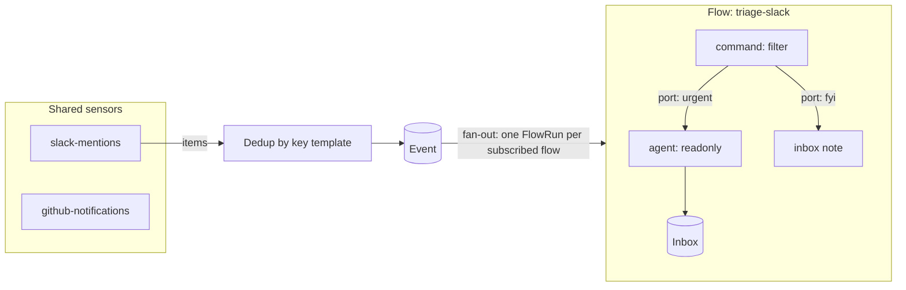
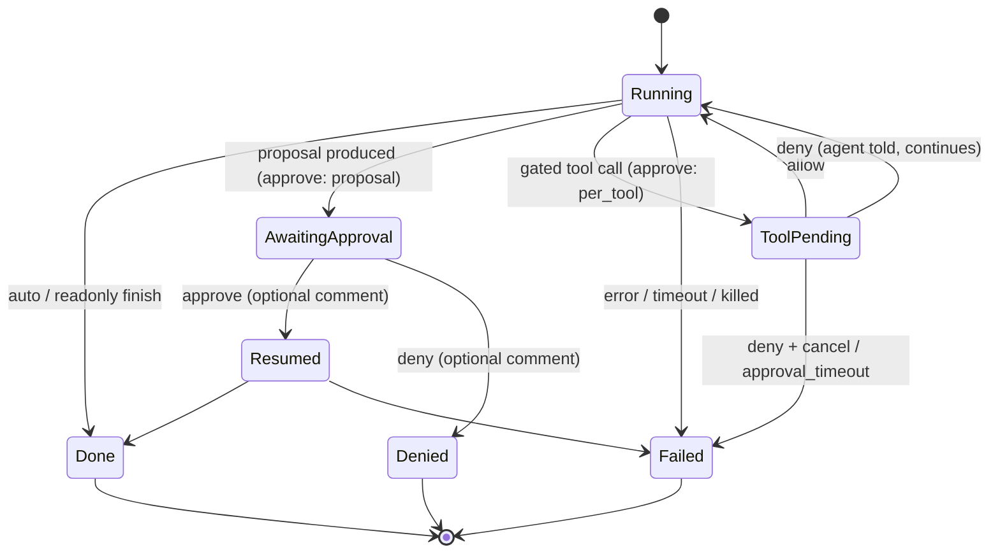

# hal9001: requirements

A local macOS daemon that polls Slack, GitHub, Linear, and Gmail, runs events through user-built flows of shell-command nodes, and hands selected events to coding agents (Claude Code, Codex, omp) under one of three autonomy modes. A localhost web UI provides a visual flow editor (n8n style) and full traceability of every event, decision, and agent run.

## 1. Goals and non-goals

Goals
- One place that watches the systems I bounce between and triages for me.
- Plain code (any language, via stdin/stdout) decides what reaches an agent; agents are invoked with selectable, pre-canned prompts.
- Deep traceability: for any outcome I can see the source item, every node's exact input/output/command/exit code, the agent transcript, and what was approved.
- Build and debug flows visually: canvas, per-node test runs, replay, dry-run.

Non-goals (v1)
- Webhooks, Slack Socket Mode, or any inbound public endpoint. Polling only.
- Multi-user, auth beyond localhost protection, remote hosting.
- Embedded scripting VM. Nodes are processes.
- Join/merge nodes, loops, sub-flows.
- Direct LLM API calls (agents only, over ACP).
- ACP client `fs`/`terminal` capabilities (agents use their own tools).
- Per-flow daily budgets (concurrency + timeouts + kill switch only).
- Keychain secret management.

## 2. Concepts



| Term | Meaning |
|---|---|
| Sensor | Shared, scheduled command that prints items (JSON array or JSONL). Defined once, subscribed to by many flows. |
| Item / Event | One item from a sensor that passes dedup. Immutable, stored. |
| Flow | DAG of nodes subscribed to 1+ sensors. YAML file. |
| FlowRun | One execution of one flow for one event (or replay / manual test). |
| Node | `command`, `agent`, or `inbox`. Has named output ports. |
| NodeRun | One execution of a node within a FlowRun. |
| AgentRun | Agent CLI session(s) behind an agent NodeRun, incl. full transcript. |
| Prompt | Reusable prompt template file selected by agent nodes. |
| Inbox item | Structured note for me (from read-only agents or `inbox` nodes). |
| Approval | Pending proposal from an approve-mode agent. |

## 3. Storage layout

Home dir defaults to `~/.hal9001` (override `--home`). Config files are meant to be git-versioned; runtime data is not.

```
~/.hal9001/
  config.yaml          # port, concurrency, retention, defaults
  env                  # KEY=VALUE, injected into every node (SLACK_USER_TOKEN, LINEAR_API_KEY, ...)
  sensors/*.yaml
  flows/*.yaml
  prompts/*.md
  data/hal.db          # SQLite (traces, events, inbox, approvals, flow versions)
  data/blobs/          # large stdout/stderr/transcripts, content-addressed
  data/state/<node>/   # persistent per-sensor/per-node scratch dir ($HAL_STATE_DIR)
  data/worktrees/<run>/
```

- Config files are hot-reloaded on change (fsnotify). The UI writes YAML; if the file changed on disk since the UI loaded it (hash mismatch), the save is rejected with a conflict.
- Every FlowRun records the content hash of the flow YAML; each distinct version is snapshotted in `flow_versions` so traces always show the exact flow that ran.

## 4. Node execution contract (applies to sensors and command nodes)

Process model:
- `lang: bash | python | node | jq | exec`. Inline `script` is written to a temp file and run with the interpreter (`bash`, `python3`, `node`, `jq -c -f`). `exec` runs `command: [argv...]` directly.
- stdin: the node's input payload (JSON). For the first node this is the sensor item.
- stdout: output, parsed as one JSON value or JSONL.
- stderr: captured as logs, shown in trace.
- Working dir: node's `$HAL_STATE_DIR` unless `cwd` set.

Result semantics:

| stdout | exit | Meaning |
|---|---|---|
| empty | 0 | **Drop**: branch ends, recorded as decision `dropped` (so `jq 'select(...)'` is a filter). |
| one JSON value | 0 | Emit on port `out` (or `_port` if present). |
| JSONL, N lines | 0 | Emit N payloads (split/fan-out), each routed by its own `_port`. |
| any | ≠0 | Error. Routed to implicit `error` port if wired, else branch fails. |
| any | killed by timeout | Error `timeout`. |

- Reserved keys in an output object: `_port` (string, routing), `_reason` (string, shown as decision reason in the trace). Both stripped before passing downstream.
- A `_port` not declared on the node is an error.

Environment injected into every process:

| Var | Value |
|---|---|
| everything in `env` file | |
| `HAL_EVENT_FILE` | path to original event JSON |
| `HAL_RUN_ID`, `HAL_EVENT_ID`, `HAL_FLOW`, `HAL_NODE` | ids |
| `HAL_STATE_DIR` | persistent dir for this sensor/node |
| `HAL_DRY_RUN` | `1` in dry-run |
| `HAL_LAST_SUCCESS_AT` | sensors only: RFC3339 of last successful poll (for incremental fetch) |

PATH: the daemon runs under launchd, which has a minimal PATH. `hal9001 install` captures the user's login-shell `PATH` into the launchd plist so mise shims, `gh`, `jq`, etc. resolve.

## 5. Sensors

```yaml
# sensors/github-notifications.yaml
id: github-notifications
interval: 2m              # or cron: "*/5 9-18 * * 1-5"
lang: bash
script: |
  gh api notifications --paginate -q '.[]' 
key: "{{.id}}:{{.updated_at}}"   # Go text/template over the item; configurable re-trigger
first_run: baseline       # baseline = mark all seen without firing; fire = emit everything
timeout: 60s
```

- Output: JSON array or JSONL of items. Each item gets a dedup key from the `key` template; unseen keys become Events.
- Every poll is recorded (SensorRun: start, duration, item count, new count, stdout/stderr, exit code). Failures are shown on the sensor page and don't advance `HAL_LAST_SUCCESS_AT`.
- Manual "Poll now" button. Sensors pause with the kill switch.
- Starter sensors shipped in `sensors/` (editable templates):

| Sensor | Mechanism | Credential | Key |
|---|---|---|---|
| slack-mentions-dms | curl `search.messages` (mentions) + `conversations.list/history` (IMs) | `SLACK_USER_TOKEN` (xoxp; `search:read`, `im:history`, `im:read`, `users:read`) | `{{.channel}}:{{.ts}}` |
| github-notifications | `gh api notifications` (incl. review requests) | existing `gh` auth | `{{.id}}:{{.updated_at}}` |
| linear-assigned | curl GraphQL: assigned issues + comments updated since `HAL_LAST_SUCCESS_AT` | `LINEAR_API_KEY` | `{{.id}}:{{.updatedAt}}` |
| gmail-unread | Gmail CLI query `is:unread in:inbox` | CLI's own OAuth | `{{.id}}` |

Gmail CLI: neither `gog` nor `gws` is installed yet. Default choice `gog`; the template is verified once installed (see §13).

## 6. Flows

```yaml
# flows/triage-github.yaml
id: triage-github
enabled: true
dry_run: false
subscribe: [github-notifications]
max_concurrent: 2
nodes:
  - id: only-review-requests
    type: command
    lang: jq
    script: 'select(.reason == "review_requested") | . + {_reason: "review requested"}'
    ui: {x: 100, y: 80}

  - id: classify
    type: command
    lang: python
    ports: [small, large]
    script: |
      import json, sys, subprocess
      ev = json.load(sys.stdin)
      # ... call gh to get PR size ...
      ev["_port"] = "small" if additions < 200 else "large"
      print(json.dumps(ev))

  - id: review-small
    type: agent
    runtime: claude          # key in config.yaml `runtimes` (claude | codex | omp | ...)
    mode: approve            # auto | approve | readonly
    approve: proposal        # proposal | per_tool (approve mode only)
    prompt: pr-review        # prompts/pr-review.md
    extra_prompt: "Focus on tests."
    model: sonnet
    cwd: {mode: worktree, repo: "~/code/{{.input.repository.name}}", ref: "origin/main"}
    timeout: 20m

  - id: note-large
    type: inbox
    title: "Large PR needs you: {{.input.subject.title}}"
    priority: high
    summary_md: "{{.input.subject.url}}"

edges:
  - {from: only-review-requests, to: classify}
  - {from: classify, port: small, to: review-small}
  - {from: classify, port: large, to: note-large}
```

Rules
- Graph must be a DAG; validated on load and save (cycles, unknown nodes, undeclared ports, unreachable nodes → error shown in editor).
- Entry nodes = nodes with no incoming edges; each receives the event.
- Fan-out: one output port can feed multiple nodes; they run concurrently.
- Implicit ports on every node: `error`. Agent nodes also have `denied` (approve mode).
- `side_effect: true` on command nodes marks them as acting on the world; skipped (recorded as `skipped:dry_run`) in dry-run.
- Templates (`key`, `cwd`, `inbox` fields, prompts) use Go `text/template` with data `{.event, .input, .flow, .run}` (`.input` = node input payload) plus a few helpers (`json`, `default`, `trunc`).

## 7. Agent nodes

### 7.1 Prompts

```markdown
---
name: pr-review
description: Review a PR and leave comments
output: note            # note = structured inbox schema (§7.4); none = free text
---
You are reviewing {{.input.subject.url}}.
...
```

Agent node selects a prompt from the library (dropdown in UI) plus optional `extra_prompt`. The rendered prompt is stored on the AgentRun.

### 7.2 Modes

All agents are driven over ACP (§7.3). The harness is the ACP client, so every permission request from the agent comes to the harness and is decided by policy or by me, and recorded.



| Mode | Behavior | Output |
|---|---|---|
| `auto` | Agent in its most permissive session mode; the harness allows every permission request (still recorded). | Port `out`; inbox item only if prompt `output: note`. |
| `approve` + `proposal` (default) | Phase 1 runs under the read-only policy, with a prompt suffix: "investigate, then propose a concrete plan; do not change anything". The agent process exits after the proposal, which becomes an Approval plus a notification. Approve resumes the **same session** (`session/load`) under the auto policy, with "Approved. Execute the plan." plus my comment. Deny is recorded and routes to port `denied`. | Port `out` after phase 2. |
| `approve` + `per_tool` | One session under a gated policy: read-class tool calls are allowed automatically; every other permission request becomes an Approval showing the tool, its kind, and its input or diff. Allow continues the call. Deny rejects that call and the agent continues. Deny + cancel ends the run (`denied`). The agent process stays alive while it waits; after `approval_timeout` (default 1h) the request is rejected and the run fails with `approval_timeout`. | Port `out`. |
| `readonly` | Read-only policy; produces a structured note. | Inbox item + macOS notification; port `out`. |

FlowRuns waiting on an approval have status `awaiting_approval`; downstream nodes run after the agent finishes. Proposal approvals never expire and survive daemon restarts. Per-tool approvals die with the agent process: a daemon restart marks them `expired` and the run `interrupted`.

Permission policy (harness side, applied to every `session/request_permission`):

| Policy | Allowed automatically | Everything else |
|---|---|---|
| read-only | ACP tool kinds `read`, `search`, `fetch`, `think`; plus node `allow` rules | rejected, with the reason recorded |
| gated (`per_tool`) | same as read-only | sent to the approval queue |
| auto | all | n/a |

Node `allow` rules extend the read-only set: `allow: {tools: [<regex on tool title/name>], commands: [<regex on execute-kind command>]}`. Example: `commands: ['^gh (pr|issue) (view|diff|list)\b', '^git (log|diff|show)\b']` lets a triage agent use `gh` without being able to post. MCP tools (kind `other`) are rejected unless listed in `allow.tools`.

Limit: a permission request only reaches the client when the agent's own session mode asks for permission. Tools the agent auto-approves, such as an allow-list in the user's Claude `settings.json` or a bypass mode, never reach the harness. Each run must therefore set the agent's most restrictive "ask" mode for read-only/gated policies and must not inherit auto-allow settings. The adapter gate (§13) verifies this per runtime; a runtime that fails it cannot run `readonly` or `approve` nodes until fixed.

### 7.3 Agent transport: ACP

One Go ACP client (`github.com/coder/acp-go-sdk`) over stdio. A runtime is just a configured command; adding another ACP agent (e.g. Gemini CLI) needs only config.

```yaml
# config.yaml
runtimes:
  claude: {command: [claude-agent-acp], modes: {ask: default, full: bypassPermissions}}
  codex:  {command: [codex-acp],        modes: {ask: read-only, full: full-access}}
  omp:    {command: [omp, acp],         modes: {ask: TBD, full: TBD}}
```

Adapters are installed globally at pinned versions (not run through `npx`) so startup is fast and versions don't drift. The mode names above are placeholders until the gate in §13 confirms the real ones.

Session lifecycle per agent NodeRun:
1. Spawn the runtime command in the run cwd; `initialize`. Record agent info and capabilities. The client advertises **no** `fs` or `terminal` capabilities in v1, so agents use their own tools.
2. `session/new` with `cwd` and optional node `mcp_servers` (passed through ACP); set the session mode for the policy; set the model if the node specifies one and the agent supports it.
3. `session/prompt` with the rendered prompt. Stream `session/update` notifications (message chunks, thoughts, `tool_call`, `tool_call_update`, plan) into `agent_events`. Answer `session/request_permission` per §7.2.
4. End on the prompt response (`stopReason`). Parse the structured result from the final agent message (§7.4).
5. Timeout, kill switch, or deny + cancel: `session/cancel`, then answer any outstanding permission requests with `cancelled`, then SIGTERM/SIGKILL the process group.
6. Proposal resume: spawn, `initialize`, `session/load` (only if the agent advertises `loadSession`), then `session/prompt` with the approval message. If the agent lacks `loadSession`: `session/new` with a prompt containing the original prompt, the proposal, and my comment. The fallback is recorded on the AgentRun.

Raw JSON-RPC traffic per AgentRun is kept as a blob for debugging.

Fallback: if a runtime fails the §13 gate and can't be fixed through configuration, that runtime alone gets a CLI-exec adapter (`claude -p --output-format stream-json`, `codex exec --json`, `omp -p --mode json`) behind the same Go interface. It is built only if the gate requires it.

### 7.4 Structured note schema

```json
{
  "title": "string",
  "priority": "low | normal | high | urgent",
  "summary_md": "markdown",
  "suggested_reply": "string, optional",
  "links": [{"label": "string", "url": "string"}]
}
```

If parsing fails, the inbox item is created with the raw final message, `priority: normal`, and a `parse_error` flag visible in the UI.

### 7.5 Working directory

- `cwd: {mode: dir, path: "<template>"}`: run in an existing directory.
- `cwd: {mode: worktree, repo: "<template>", ref: "<ref>"}`: `git fetch` then `git worktree add data/worktrees/<run> <ref>` (detached). Removed when the run succeeds; kept when it fails or while it awaits approval; removed by retention pruning.
- Default: `data/state/<flow>/<node>/`.

## 8. Execution engine

- Sensor scheduler: one goroutine per sensor; skips a tick if the previous poll is still running.
- Event → FlowRun fan-out for each enabled, subscribed flow. Each FlowRun executes its DAG; node outputs are persisted before downstream nodes start.
- Queues persisted in SQLite. Concurrency: `config.yaml` `max_agent_runs` (global, default 2), flow `max_concurrent` (default 2), command-node pool (default 8). Excess runs wait as `queued` and are visible in the UI.
- Timeouts per node (default: command 60s, agent 30m); kill whole process group.
- Kill switch: pauses sensors and stops starting new nodes. Optionally "pause + kill running" (SIGTERM, then SIGKILL after 10s; runs marked `killed`). State persisted.
- Daemon restart: in-flight NodeRuns → `interrupted` (not auto-retried); queued runs resume; proposal approvals preserved; per-tool approvals → `expired`.
- Replay: re-run a stored event through the **current** version of a flow → new FlowRun linked to the original (`replay_of`). Optional dry-run toggle at replay time.
- Run node on sample: in the editor, execute one node against a chosen input (a stored event, an upstream NodeRun output, or pasted JSON). Recorded as a FlowRun with `kind: test` (filtered out of default timeline views).
- Dry-run per flow: agent nodes forced to `readonly`, `side_effect` nodes skipped, `HAL_DRY_RUN=1`, inbox items tagged `dry-run`.

## 9. Trace model (SQLite)

| Table | Key fields |
|---|---|
| sensor_runs | sensor_id, started/ended, exit, item_count, new_count, stdout/stderr blob refs |
| events | id, sensor_id, sensor_run_id, dedup_key, payload, created_at |
| flow_versions | flow_id, hash, yaml |
| flow_runs | id, flow_id, flow_hash, event_id, kind (live/replay/test), replay_of, dry_run, status, timestamps |
| node_runs | id, flow_run_id, node_id, parent_node_run_id, status, decision (emitted/dropped/error/skipped), reason, port(s), command/script snapshot, env keys (values redacted), stdin, stdout, stderr, exit, duration |
| agent_runs | id, node_run_id, runtime, agent info + capabilities from `initialize`, mode, approve style, policy, phase (propose/execute), session_id, resumed_via (load/new_session), cwd, rendered prompt, argv, status, stop_reason, result JSON, raw JSON-RPC blob |
| agent_events | agent_run_id, seq, ts, kind (message/thought/tool_call/tool_call_update/plan/...), tool_call_id, payload (the `session/update` body) |
| permission_requests | id, agent_run_id, tool_call_id, tool kind, title, raw input, options offered, decision (allow/reject/cancelled/expired), decided_by (policy/user/timeout), matched rule, reason, timestamps |
| approvals | id, agent_run_id, type (proposal/tool_call), permission_request_id (tool_call only), proposal_md, status, decided_at, comment |
| inbox_items | id, source (agent_run/node_run), title, priority, summary_md, suggested_reply, links, read, starred, archived, dry_run |

- Payloads > 64 KiB are stored as blobs (content-addressed, zstd).
- Secret redaction: values from the `env` file are replaced with `«KEY»` in stored stdout/stderr/argv.
- Retention: `retention_days` (default 30). Nightly prune of runs, events, blobs, and worktrees older than that, except anything linked to a starred inbox item or a pending approval. Dedup keys are retained longer (`dedup_retention_days`, default 180) so old items don't re-fire.

## 10. Daemon and OS integration

- Single Go binary, frontend embedded via `go:embed`.
- CLI: `hal9001 serve`, `install` / `uninstall` (launchd LaunchAgent, `KeepAlive`, logs to `~/Library/Logs/hal9001/`), `open` (opens UI), `validate` (lint sensors/flows/prompts), `pause` / `resume`.
- HTTP on `127.0.0.1:9001` only. Local protection, because a localhost UI that runs commands is reachable from any webpage via CSRF or DNS rebinding:
  - reject requests whose `Host` is not `127.0.0.1:9001` / `localhost:9001`;
  - mutating requests require an `X-Hal-Token` header matching a per-install token (served to the UI only via the same-origin index page); reject cross-origin `Origin`.
- Notifications via `terminal-notifier` (installed) with `-open http://localhost:9001/...` deep links; fallback `osascript`. Sent for inbox items with priority ≥ configured threshold (default `normal`) and every new approval.
- Live updates to the UI via SSE (`/api/stream`): sensor runs, events, run/node status changes, agent transcript events, inbox, approvals.

## 11. Web UI

Stack: React + TypeScript + Vite, `@xyflow/react` (React Flow) canvas, CodeMirror for script editing, Tailwind. Built assets embedded in the binary.

Header (all pages): kill-switch toggle, running/queued counts, pending-approval and unread-inbox badges.

| Page | Contents |
|---|---|
| Timeline | Live feed of events and FlowRuns; filters by sensor, flow, status, decision, kind; search over payload text. |
| Event detail | Raw payload, dedup key, sensor run; fan-out tree of FlowRuns across flows, with each branch's decision path. "Replay into flow…" |
| Run detail | Flow graph read-only with per-node status overlay (emitted/dropped/error/skipped/running/awaiting); click node → stdin, stdout, stderr, exit, duration, command/script snapshot, env keys, reason. Link to the flow version used. |
| Agent run | Agent info and capabilities, rendered prompt, argv, cwd, phase timeline (propose → approval → execute), streaming transcript (messages, thoughts, plan, tool calls with input/output/diffs, collapsible), every permission request with its decision, who made it, and the matched rule, final result JSON, raw JSON-RPC download. |
| Inbox | Notes sorted by priority/time; read/star/archive; copy suggested reply; links; "open trace". |
| Approvals | Pending queue of both types. Proposal: proposal markdown, originating event, agent context, Approve / Deny with comment. Tool call: tool title, kind, input or diff, time left until `approval_timeout`, Allow / Deny / Deny + cancel run. History tab. |
| Flows | List (enabled, dry-run, last run, error rate). Editor: canvas with node palette (command, agent, inbox) and sensor subscription nodes; drag/drop, connect ports; side panel config + CodeMirror; validation errors inline; "Run node on sample" with input picker and result pane; save writes YAML. |
| Sensors | List with status, last poll, new items, errors; edit (same code editor), "Poll now", recent SensorRuns. |
| Prompts | List / edit prompt files with preview rendered against a sample event. |
| Settings | Concurrency, retention, notification threshold, env file keys (names only, values masked), kill switch. |

## 12. Acceptance scenarios (what I will test)

1. `hal9001 install` → daemon running after login; `localhost:9001` loads; `gh`/`jq` resolve inside nodes.
2. A test sensor (`lang: bash`, emits 3 items) with `first_run: fire` creates 3 events; next poll with the same output creates 0; changing an item's `updated_at` with key `{{.id}}:{{.updated_at}}` creates 1.
3. `first_run: baseline` on GitHub notifications creates no events on first poll; a new notification afterwards creates exactly one.
4. Flow with jq filter: non-matching events show `dropped` with reason in the run detail; matching continue.
5. Router node: `_port: urgent` vs `fyi` routes to different nodes; undeclared port → error visible in trace.
6. Readonly Claude agent produces an inbox item with title/priority and a macOS notification that deep-links to it; transcript visible in agent run page.
7. Approve-mode agent with `approve: proposal` (each of claude, codex, omp): proposal appears in Approvals + notification; Approve resumes the same session (`resumed_via: load`, or `new_session` with the fallback recorded) and executes; Deny ends with port `denied`; both decisions in trace.
7a. Approve-mode agent with `approve: per_tool`: a read is allowed by policy without asking; a file edit appears in Approvals with its diff; Allow applies it; Deny rejects it and the agent continues; letting `approval_timeout` (set to 1m) expire fails the run.
7b. Readonly agent asked to edit a file or post via an MCP tool: the request is rejected by policy and recorded with the reason; the file is unchanged. With `allow.commands: ['^gh pr view']`, `gh pr view` is allowed and `gh pr comment` is rejected.
8. Auto-mode agent in `worktree` cwd makes a change in an isolated worktree, not the source repo.
9. Dry-run flow: agent forced readonly, `side_effect` node shown `skipped:dry_run`, inbox item tagged.
10. Replay an old event into an edited flow → new run linked to original, shows new flow hash.
11. Run node on sample from the editor shows stdout/stderr/exit without creating timeline noise.
12. Concurrency: 5 agent-bound events with `max_agent_runs: 2` → 2 running, 3 queued, all complete.
13. Timeout: `sleep 999` command node with `timeout: 2s` → `timeout` error, process gone.
14. Kill switch: sensors stop polling; "pause + kill" terminates a running agent; state survives restart.
15. Restart daemon mid-run → run marked `interrupted`; pending approval still approvable.
16. Edit a flow in the UI → YAML file updated; edit the YAML by hand → UI reflects it; conflicting save rejected.
17. Secrets from `env` never appear unredacted in any trace view.
18. Cross-origin POST to `localhost:9001/api/...` without the token → rejected.
19. Starter sensors (Slack, GitHub, Linear, Gmail) poll successfully with real credentials.

## 13. Prerequisites and open items

| Item | Owner | Status |
|---|---|---|
| `SLACK_USER_TOKEN` (xoxp) with scopes in §5 | me | to create |
| `LINEAR_API_KEY` | me | to create |
| Gmail CLI: install `gog` (or choose `gws`) and log in | me | not installed |
| Install pinned ACP adapters: `claude-agent-acp`, `codex-acp` (omp has `omp acp` built in) | build | not installed |
| **ACP gate**, per runtime: (1) restrictive session mode name and confirmation that edit/execute/MCP tool calls reach `session/request_permission` in that mode, including when the user's own agent settings auto-allow tools; isolate settings if needed; (2) `loadSession` support and resume behavior; (3) model selection; (4) which settings, MCP servers, and project instructions load compared with the normal CLI; (5) tool-call `kind` and `rawInput` shape for execute tools, which `allow.commands` needs | build | first build task; results go in `docs/acp-gate.md` and fill `runtimes` in `config.yaml` |

## 14. Build plan (sub-agents)

Phase 0 (sequential except the ACP gate, which runs in parallel): repo skeleton, Go module, `internal/spec` (YAML types + validation), SQLite schema + migrations, store interfaces, HTTP API contract (`docs/api.md` + `web/src/api/types.ts`), node execution contract tests. Everything else builds against these. The ACP gate (§13) runs alongside; its results decide whether any CLI-exec fallback adapter is needed.

Phase 1 (parallel):

| Slice | Scope |
|---|---|
| Engine | sensor scheduler, dedup, command runner (langs, env, timeouts, process groups, redaction), DAG executor, queues/concurrency, kill switch, replay, test runs, dry-run, retention |
| Agents | Go ACP client on `acp-go-sdk`, session lifecycle (§7.3), permission policy engine + `allow` rules, proposal and per-tool approval, `session/load` resume with fallback, worktrees, transcript storage, note parsing; a CLI-exec fallback adapter only for runtimes that fail the gate |
| Server | REST API, SSE hub, token/Host/Origin protection, notifications, launchd install, CLI commands, config hot-reload, YAML write with conflict detection |
| Web | all pages in §11 against the API contract with fixtures, then against the live server |
| Content | starter sensors, prompts (`triage-slack`, `pr-review`, `linear-triage`, `email-secretary`), example flows, `validate` fixtures |

Phase 2: integration, end-to-end smoke of §12 scenarios against a fake sensor and real CLIs, browser verification of the UI, README with setup steps.
