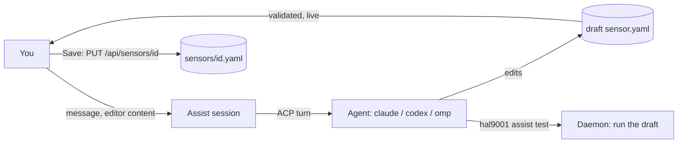

# AI-assisted sensor authoring

From the Sensors page you can ask a coding agent to write a sensor ("Create with AI") or change one ("Ask AI"). A chat
session opens next to the editor, you describe what you want, and the agent edits a **draft** of the sensor that appears
live in the editor. It tests the draft through the daemon, you test it yourself, and you save with the normal Save button.
Everything is a REST endpoint first (`api/openapi.yaml`, tag `assist`); the UI and the CLI are clients of it.



## The rules that matter

- **The agent never writes a real sensor file.** It edits a file in its private draft directory. Only your Save, through
  the ordinary sensor create/update endpoints (with `expected_hash`), writes `sensors/<id>.yaml`. A session on an existing
  sensor starts from that file and leaves it untouched until you save.
- **The agent is never given a secret.** Its environment holds no value from the `env` file or any `env.d/sensors/*.env`
  file, and it is told only the variable **names** it can use. To run the draft it asks the daemon (`hal9001 assist test`),
  which runs it with the secrets and returns the **redacted** result. See [Secrets](#secrets).
- **Every turn is an agent run**, linked to the session, visible on the Agent run page with its transcript, permission
  requests and approvals. Nothing the agent does is off the record.
- **Anything beyond editing the draft and the two helper commands asks you**, inline in the chat.

## Using it

1. `POST /api/assist/sessions` with `{target: {kind: "sensor", id?}, runtime, model?, yaml?}` creates a session. With `id`
   the draft starts from the sensor's file (or from `yaml`); without it, from `yaml` or a commented skeleton. `runtime` is
   a key of `runtimes` in `config.yaml` (`claude`, `codex`, `omp`). No agent process runs yet.
2. `POST /api/assist/sessions/{id}/messages` with `{text, yaml?}` starts one turn (202). `yaml`, when sent, first replaces
   the draft, so the agent sees what is in your editor. 409 while a turn runs, 423 while the kill switch is engaged.
3. Watch `GET /api/stream?assist_session_id=<id>` for `assist.updated` (status, draft) and `assist.message` (conversation).
   The same stream carries the session's `agent_run.*` and `approval.*` events. `GET /api/assist/sessions/{id}` returns the
   whole state.
4. A tool call that needs you shows up as a message with `approval_id`. Decide it with the normal
   `POST /api/approvals/{id}/approve|deny` (service `approve`): Allow, Deny, or Deny with `cancel_run` to stop the turn.
5. `PUT /api/assist/sessions/{id}/draft` hands your editor content to the session (guarded by `expected_hash`, so you do not
   overwrite an edit the agent made meanwhile). `POST .../test` runs the draft yourself. `POST .../cancel` cancels the
   running turn. `DELETE /api/assist/sessions/{id}` ends the session.
6. Save the sensor with `PUT /api/sensors/{id}` (or create it with `POST /api/sensors`) using the draft's YAML.

Session status: `idle`, `running`, `awaiting_approval` (a tool call is waiting for you), `failed` (the last turn failed,
`error` says why; the session still takes a message), `closed`.

The draft (`yaml`, `hash`, `sensor_id`, `diagnostics`, `updated_at`, `updated_by`) is validated like a sensor file after
every change; `updated_by` says whether you or the agent wrote it. For an existing sensor, a changed `id` is flagged with an
`id_mismatch` warning: saving would create a different sensor.

### CLI

```
hal9001 assist create --runtime claude [--sensor ID] [--model M] [--yaml FILE|-]
hal9001 assist list [--target-kind sensor] [--target-id ID]
hal9001 assist get <session>              # session with messages
hal9001 assist send <session> <text...> [--yaml FILE|-]
hal9001 assist cancel [<session>]
hal9001 assist close <session>
hal9001 assist test [<session>]           # the AssistTestResult JSON
hal9001 assist draft [<session>]          # the draft and its diagnostics
hal9001 sensors validate [file.yaml|-]    # the sensor format check, no save
```

`test`, `draft` and `cancel` default to the session in `HAL9001_ASSIST_SESSION`, which the daemon sets for the agent.

## The draft directory

`<home>/data/assist/<session>/` (mode 0700) holds:

| File | Purpose |
|---|---|
| `sensor.yaml` | The draft. The only file the agent edits. The daemon compares it with its stored copy after every tool call, every 400 ms during a turn, and at the end of the turn; a change is validated and published as `assist.updated` (`updated_by: agent`). |
| `AGENTS.md`, `CLAUDE.md` | The same instructions under the names the agents read: the sensor format and node contract, the output rules (JSON array or JSONL), the dedup `key` template rules, `first_run`, the env variable **names** available (global env file plus the target sensor's own), how to test, and the rules (edit only `sensor.yaml`, never print or ask for secrets, keep the id stable when editing, end each turn with a short plain-language summary). Rewritten at every turn so the names are current. |

The working directory of the agent is this directory. The directory is removed when the session is deleted, and by retention
for sessions that were left open.

## Permission policy

Each turn runs under the **gated** policy of [REQUIREMENTS §7.2](../REQUIREMENTS.md): the runtime is put in its restrictive
"ask" mode (`modes.ask` / `ask.args` of the runtime), so every non-read tool call reaches the daemon.

| Tool call | Decision |
|---|---|
| Read, search, fetch, think | Allowed (rule `kind:<kind>`), except on a protected file (below). |
| Edit, delete or move where every target path lies inside the session's draft directory | Allowed (rule `allow.edit_under[0]`). `..` escapes, sibling directories with the same prefix, symlinks pointing out, and calls that name no path do not match. |
| Execute: `hal9001 assist test` or `hal9001 assist draft` (optionally followed by the session id), via `PATH` or the absolute path of the running binary | Allowed (rule `allow.commands[n]`). |
| Execute: `hal9001 sensors validate sensor.yaml` | Allowed. Only that file name: the command would otherwise read any file you name. |
| Any command with `;`, `&&`, `|`, redirects, `$(...)` or backticks | Not matched by the rules above, so it asks. |
| Everything else (other commands, edits elsewhere, MCP tools, `curl`, ...) | An approval of type `tool_call` (rule `policy:gated`), decided inline in the chat or in the Approvals page. Allow runs it once, Deny rejects it and the agent continues, Deny + stop ends the turn. |

Claude and omp continue after a denial. Codex's only reject option cancels the turn, so a denial ends the turn there
([acp-gate.md](acp-gate.md)); the conversation says so and the session stays usable. The client only ever picks one-shot allow
options, so an approval never persists a rule in the agent's own settings.

**Protected files.** A read-class call whose target is `env`, `env.d/`, `config.yaml`, `data/hal.db*`, `data/blobs/` or
`data/runtimes/` in the home directory is not auto-allowed; it asks like everything else. This is a policy check on the
paths a tool call names, not an operating-system sandbox: an agent that is allowed to run a command runs it with your
permissions.

Approvals raise the usual notification ("Approve tool call: sensor assistant"). A pending approval keeps the session in
`awaiting_approval`. The approval times out after `approval_timeout` (1 h) like any per-tool approval.

## Secrets

What the agent can and cannot see:

| | Agent |
|---|---|
| Names of the variables of the `env` file and of the target sensor's `env.d` file | Yes (in `AGENTS.md`, `CLAUDE.md` and the prompt) |
| Values of those variables | **No.** The agent process starts from a minimal environment (`HOME`, `USER`, `PATH`, ... as for nodes) plus `HAL9001_URL` and `HAL9001_ASSIST_SESSION`. `PATH` has the directory of the running `hal9001` binary first, so `hal9001 assist test` works. |
| Values of another sensor's `env.d` file | No, and names only for the target sensor. |
| The result of `hal9001 assist test` | Yes, **redacted**: every value of the global env file and of every sensor env file is replaced by `«KEY»` in stdout, stderr and the rendered dedup keys. |

`POST /api/assist/sessions/{id}/test` (the endpoint behind `hal9001 assist test`) runs the draft **like Poll now**: `lang`,
`script`/`command`, `cwd` and `timeout` of the draft, the `HAL_*` variables with `HAL_STATE_DIR` in a temporary directory and
no `HAL_LAST_SUCCESS_AT`, and the global env overlaid by the values of the **target** sensor (a new sensor has none: the id in
a draft never selects someone else's secrets). Output is redacted, then bounded: 64 KiB per stream inline (the whole output
as a blob beyond that), the first 200 items listed with their rendered dedup keys (`key_error` when the key template fails on
an item), `item_count` the total. The call records nothing: no sensor run, no events, no dedup keys. It answers 200 even when
the script fails (see `exit_code`, `timed_out`, `parse_error`), 422 when the draft does not parse as a sensor, 423 while
paused.

Redaction replaces the secret values the daemon knows, as everywhere else in hal9001. Two limits follow from what a sensor is:

- A test **runs the agent's code with your credentials.** A script that sends `$TOKEN` over the network, or prints it
  encoded, is not caught by value redaction. The draft is code from a model: read it (the editor shows every change) before
  you trust a credential to it, and keep the credentials of sensitive systems out of the global `env` file.
- The agent can run a test without asking (that is what makes the loop work). If you do not want an agent to execute drafts
  with a sensor's credentials, do not give the target sensor those credentials until the draft is reviewed.

Secrets never appear in the conversation, the stored transcripts or any assist/agent API response: messages, tool calls,
agent events, permission requests, raw JSON-RPC and agent-run errors are stored through the same redactor as other runs.

## Lifecycle

- **Process.** The first message starts the agent process (the same runtime resolution and isolated agent homes as agent
  nodes). It stays alive between turns and is suspended after 15 minutes without a turn.
- **Resume.** The next message restarts it and resumes the same ACP session with `session/load`. When the agent cannot load
  it, a new session starts and the prompt carries a recap of the conversation; the run records `resumed_via: new_session`
  and why (`resume_fallback`). The same happens after a daemon restart: the conversation, the draft and the ACP session id
  are in the database.
- **One turn at a time.** A second message while a turn runs is a 409. Cancel sends `session/cancel` (and ends the process if
  the agent does not answer); the session and the process stay usable.
- **Kill switch.** While paused, new messages and tests are rejected with 423 `paused`. "Pause and kill running" cancels
  running turns (status `failed`, "stopped by the kill switch").
- **Daemon restart.** A running turn ends as `interrupted`; the session is `failed` with that reason and takes the next
  message.
- **Retention.** Sessions idle (or closed) longer than `retention_days` are deleted with their messages, agent runs and
  draft directory; sessions with a pending approval are kept.

## What is stored

| Table | Contents |
|---|---|
| `assist_sessions` | Target, runtime, model, status, error, the latest validated draft (yaml, hash, parsed id, diagnostics, who wrote it), `last_agent_run_id`, the agent's own session id. |
| `assist_messages` | The conversation: user text as sent, assistant text (consecutive chunks of one turn merged into one message), one message per tool call (updated in place as it progresses: title, kind, status, raw input, content including diffs), system notes (cancelled, failed, ...), and `approval_id` for gated calls. |
| `agent_runs` | One row per turn: `assist_session_id` set, `node_run_id` null, `mode: approve`, `approve_style: per_tool`, `policy: gated`, `phase: execute`, `rendered_prompt` is what was sent (a short preamble plus your text). `agent_events`, `permission_requests` and `approvals` work as for flow runs. |

Agent run and approval JSON therefore have `node_run_id`, `flow_run_id`, `flow_id` and `node_id` null and
`assist_session_id` set for assist turns. `GET /api/agent-runs?assist_session_id=` lists a session's turns.

## Requirements and limits

- The runtime must pass the ACP gate for the gated policy ([acp-gate.md](acp-gate.md)); `hal9001 runtimes probe <name>`
  checks it. A runtime without `modes.ask` (or `ask.args`) cannot be restricted and must not be used.
- The agent's CLI talks to the daemon at `HAL9001_URL` (the daemon's own loopback address). It authenticates like any
  client; with the default auth stack the loopback request is admitted. If you removed `localhost-trust` from the stack, the
  agent's `hal9001 assist test` is refused: use the Test button (the same endpoint) from the UI instead.
- A draft is limited to 256 KiB. One agent process per open session.

## Tests

`e2e/assist_test.go` drives the whole feature with the scripted fake agent and the real `hal9001` binary: draft edits and
live diagnostics, the secret model (a test result with redacted values, no secret in the agent's environment or any API
response), approvals and denials, resume with `session/load` and with the recap fallback after the idle timeout, user
edits reaching the agent, cancel, delete (including the agent's process group), the kill switch, and restart. The live smoke
`TestLiveAssistClaudeAuthorsASensor` ([live-smoke.md](live-smoke.md)) runs one real claude turn.
