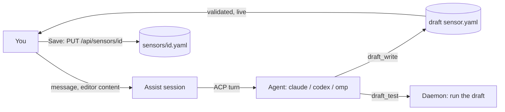

# AI-assisted sensor authoring

From the Sensors page you can ask a coding agent to write a sensor ("Create with AI") or change one ("Ask AI"). A chat
session opens next to the editor, you describe what you want, and the agent edits a **draft** of the sensor that appears
live in the editor. It tests the draft through the daemon, you test it yourself, and you save with the normal Save button.
Everything is a REST endpoint first (`api/openapi.yaml`, tag `assist`); the UI and the CLI are clients of it.



## The rules that matter

- **The agent never writes a real sensor file.** It changes a draft the daemon keeps in a private directory, through `draft_write`. Only your Save, through
  the ordinary sensor create/update endpoints (with `expected_hash`), writes `sensors/<id>.yaml`. A session on an existing
  sensor starts from that file and leaves it untouched until you save.
- **The agent is never given a secret.** Its environment holds no value from the `env` file or any `env.d/sensors/*.env`
  file, and it is told only the variable **names** it can use. To run the draft it calls `draft_test`,
  which runs it with the secrets and returns the **redacted** result. See [Secrets](#secrets).
- **Every turn is an agent run**, linked to the session, visible on the Agent run page with its transcript, permission
  requests and approvals. Nothing the agent does is off the record.
- **The agent has no other tools than hal's.** A call that needs your approval asks you inline in the chat. That includes the agent's
  first test of a script you have not seen: a test runs the script with your real credentials, so a changed script is an
  approval whose description shows the script ([Secrets](#secrets)).

## Using it

1. `POST /api/assist/sessions` with `{target: {kind: "sensor", id?}, runtime, model?, yaml?}` creates a session. With `id`
   the draft starts from the sensor's file (or from `yaml`); without it, from `yaml` or a commented skeleton. `runtime` is
   a key of `runtimes` in `config.yaml` (`claude`, `codex`, `omp`). No agent process runs yet.
2. `POST /api/assist/sessions/{id}/messages` with `{text, yaml?}` starts one turn (202). `yaml`, when sent, first replaces
   the draft, so the agent sees what is in your editor. 409 while a turn runs. The kill switch does not apply to assist: turns and draft tests (flow tests included) run while it is engaged, and "pause and kill running" leaves them alone (Stop and daemon shutdown still end them).
3. Watch `GET /api/stream?assist_session_id=<id>` for `assist.updated` (status, draft) and `assist.message` (conversation).
   The same stream carries the session's `agent_run.*` and `approval.*` events. `GET /api/assist/sessions/{id}` returns the
   whole state.
4. A tool call that needs you shows up as a message with `approval_id`. Decide it with the normal
   `POST /api/approvals/{id}/approve|deny` (service `approve`): Allow, Deny, or Deny with `cancel_run` to stop the turn.
5. `PUT /api/assist/sessions/{id}/draft` hands your editor content to the session (guarded by `expected_hash`, so you do not
   overwrite an edit the agent made meanwhile). `POST .../test` runs the draft yourself and approves its script for the agent's later tests. `POST .../cancel` cancels the
   running turn. `DELETE /api/assist/sessions/{id}` ends the session.
6. Save the sensor with `PUT /api/sensors/{id}` (or create it with `POST /api/sensors`) using the draft's YAML.
   Creating a sensor whose id is the draft's id of a session on a new sensor makes that session a session on the sensor
   (`target.id` is set): the agent is told the sensor's own env variable names and tests with their values from then on, and
   the session is offered by "Ask AI" on that sensor.

Session status: `idle`, `running`, `awaiting_approval` (a tool call is waiting for you), `failed` (the last turn failed,
`error` says why; the session still takes a message), `closed`.

The draft (`yaml`, `hash`, `sensor_id`, `diagnostics`, `updated_at`, `updated_by`) is validated like a sensor file after
every change; `updated_by` says whether you or the agent wrote it. For an existing sensor, a changed `id` is flagged with an
`id_mismatch` warning: saving would create a different sensor.

### CLI

```
hal9001 assist create --runtime claude [--sensor ID] [--model M] [--yaml FILE|-]
hal9001 assist list [--target-kind sensor] [--target-id ID]
hal9001 assist get <session>              # session with messages
hal9001 assist send <session> <text...> [--yaml FILE|-]
hal9001 assist cancel [<session>]
hal9001 assist close <session>
hal9001 assist test [<session>]           # the AssistTestResult JSON
hal9001 assist draft [<session>]          # the draft and its diagnostics
hal9001 sensors validate [file.yaml|-]    # the sensor format check, no save
```

`test`, `draft` and `cancel` default to the session in `HAL9001_ASSIST_SESSION`, which the daemon sets for the agent.

## The draft directory

`<home>/data/assist/<session>/` (mode 0700) holds:

| File | Purpose |
|---|---|
| `sensor.yaml` | The draft, written by the daemon on `draft_write` (the agent cannot touch files). |

The authoring guide (the sensor format and node contract, the output rules, the dedup `key` template rules, `first_run`, the env variable **names** available, how to test, and the rules) is returned by `draft_read` with path `instructions`, built fresh so the names are current.

The directory is removed when the session is deleted, and by retention
for sessions that were left open.

## Tools and permissions

The agent has **no file or shell access** (see [acp-lockdown.md](acp-lockdown.md)). It reads and changes the draft only
through hal's MCP tools, and each turn starts with the hal context block (session and run ids, time, tool summary):

| Tool | What it does | Approval |
|---|---|---|
| `draft_read` | The draft with its validation diagnostics. `path` also reads `instructions` (the authoring guide), `prompts/<name>.md` and, in flow sessions, `sensors/<id>.yaml` (the draft sensor, else the saved one; `sensors` lists the drafts) and `reference/<file>` (read-only; a directory lists its entries). | never |
| `draft_write` | Replaces the draft, or in flow sessions a draft prompt `prompts/<name>.md` or draft sensor `sensors/<id>.yaml`; returns the diagnostics. | never |
| `validate` | The draft's diagnostics. | never |
| `draft_test` (`sample`, `event`, `sensor`, `from_sensor` + `item` for flows) | Runs the draft like a poll or one flow run with your credentials; redacted result. | **When the script changed** since you last tested or approved it (or since the saved sensor's script): a `tool_call` approval whose chat message carries what runs, which credentials it mentions, and a diff against the last approved version. Allow records that script as approved; unchanged scripts run without asking. |
| `gh_api`, `pr_view`, `now`, ... | hal's always-available tools. | as for flow agents |

The agent layer allows these tools and rejects every other permission request. Approvals are decided inline in the chat
or in the Approvals page; a denial returns a tool error and the agent continues. The assist session's secrets never reach
the agent: the environment holds no env-file values and `draft_test` redacts the output.

**Draft directory of a flow session.**

| Path | Purpose |
|---|---|
| `flow.yaml` | The draft: the flow's file, or a skeleton with `enabled: false` and `dry_run: true`. The agent keeps the id stable and never enables a flow; you enable it. |
| `prompts/<name>.md` | New prompt files the agent drafts. They are validated like prompt files and listed in `draft.prompts` (`{name, yaml, exists}`); they do not change `draft.hash`. A name that is already saved is flagged: Save never overwrites it. |
| `sensors/<id>.yaml` | Sensors the agent drafts so the flow does not need another page: new ones, and edits of saved ones (the first `draft_write` of a saved id copies it in and remembers the saved file's hash). They are validated like sensor files together with the flow, which may subscribe to them, and listed in `draft.sensors` (`{id, yaml, exists, base_hash, diagnostics}`; `base_hash` is null for a new sensor). They do not change `draft.hash`. A new sensor whose name is already saved is an error; a saved sensor that changed since the copy is a warning. |
| `reference/` | **Read-only** material: `sensors/<id>.yaml` (definitions, no env values), `prompts/<name>.md` (existing prompts), `runtimes.txt` (names, kind, lockdown), `samples/<sensor>.jsonl` (up to 5 recent event payloads per sensor, redacted) with `samples/index.txt`, and `docs/flows.md` (the formats). Rebuilt every turn. It is read with `draft_read` and cannot be written. |

Every session kind (sensor, flow, tool) also gets the app's configuration under `reference/`, rebuilt every turn, with no secrets
(never env values, runtime commands, kubeconfig paths, hosts or keys): `runtimes.txt`, `sandboxes.md` (each backend id as used in
`sandbox:`, enabled or not, lifecycle, images, approval policy), `tools.md` (custom tools with params, approval and
`runs_in_sandbox`, plus the built-in tool names), `settings.md` (concurrency, approval timeout, notification priority, retention) and
`docs/agent-nodes.md` (agent and approval node fields). The per-turn preamble repeats a summary (enabled and disabled sandboxes with
images, runtime names, custom tool ids), and the instructions tell the agent to use only ids listed there and to tell the user where to
enable anything else (for example Configure > Sandboxes > Kubernetes). Validation diagnostics for an unknown or disabled sandbox, an
image outside the list, an unknown tool or an unknown runtime list the valid options.

| (`draft_read` path `instructions`) | The instructions: the flow format, the node types, **prefer `transform` nodes** for filtering, routing and reshaping (steps compile to jq; no code, no credentials, no approval), agent nodes (default `mode: readonly`; for inbox triage a prompt with `output: note`), inbox nodes, keep the id, never enable, how to test, and end each turn with a plain summary. |

The agent's tools are the ones above; `draft_write` accepts `flow.yaml`, `prompts/<name>.md` and `sensors/<id>.yaml` only.

**Sensors in a flow session.** `draft_test` with `sensor: <id>` runs a draft sensor like a poll and returns the sensor result (`sensor_id` set), under the same approval rule as a sensor session (the sensor's script, with its own env file when it edits a saved sensor). `from_sensor: <id>` (with `item`, default 0) runs the draft sensor and uses that output item as the input of the flow test; the approval then covers the sensor's script together with the flow's command nodes. Draft sensors have no events, so there are no samples for them. Save writes the sensors first (a new one with `POST /api/sensors` and its `id`, an edit with `PUT /api/sensors/{id}` and `expected_hash` = `base_hash`, which is a 409 when the file changed meanwhile), then the new prompts, then the flow; the drawer shows what will be saved first. CLI: `hal9001 assist test --sensor ID` and `--from-sensor ID [--item N]`.

**Testing a flow** (`POST /api/assist/sessions/{id}/test`, body `{sample_index | event_id | input}`, none: the first
sample). The draft is validated first (diagnostics, including `prompts/` files, are a 422). It then runs once as a
`kind: test` flow run (hidden from the default timelines; `GET /api/flow-runs/{id}` shows it) with `dry_run` forced, and
follows the edges:

- `transform` and `command` nodes run for real (dry run skips `side_effect` commands). A dropped item carries the
  transform's plain-language reason.
- **Agent nodes are not run**: they are `skipped` with the reason `assist test: agent nodes are not run`, and their branch
  ends there.
- **Inbox nodes create nothing**: the result carries the item they would create (`would_create`).

The result is `{kind: "flow", flow_run_id, status, input, nodes: [{node_id, status, decision, reason, ports, outputs,
would_create, stdout, stderr, exit_code, ...}], edges_taken}`. `GET /api/assist/sessions/{id}/samples` lists the sample
inputs (`index` is what `sample_index` and `--sample` mean); the UI offers them, recent events and pasted JSON.

**Secrets.** `command` nodes run with the global env file like real runs, so the approval rule for sensors applies to the
agent's flow tests: the identity is, per command node, `lang`, `script`, `command`, `cwd` and the credential names it
mentions (generated transform jq does not count, and renaming a node does not change it). An unapproved change asks you
(the description lists every command node and a diff against the last approved version); your own Test, an allowed agent
test, or the saved flow's code approves it. A flow without command nodes needs no approval. Results are redacted.

`e2e/assist_flow_test.go` covers it with the fake agent: a draft with a transform filter and route, an inbox node and a new
prompt, the `reference/` rejection, tests on samples (decisions, inbox preview, skipped agent node, nothing created),
approval for command nodes and none for a transform-only flow, Save through the normal endpoints, and an existing flow left
untouched until Save.
