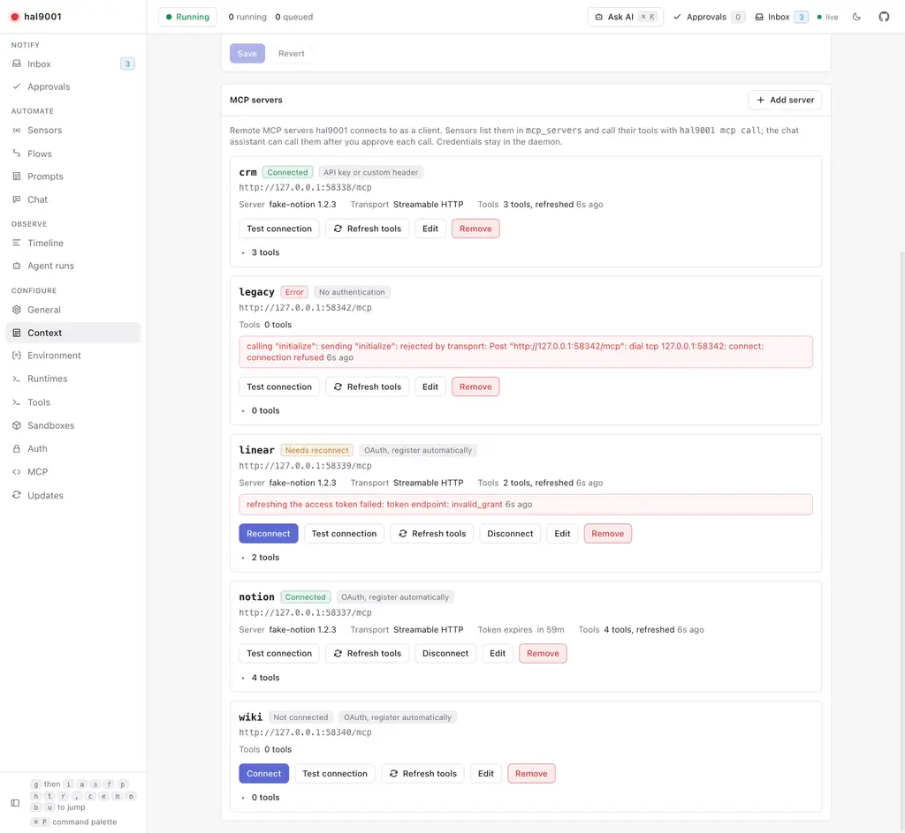
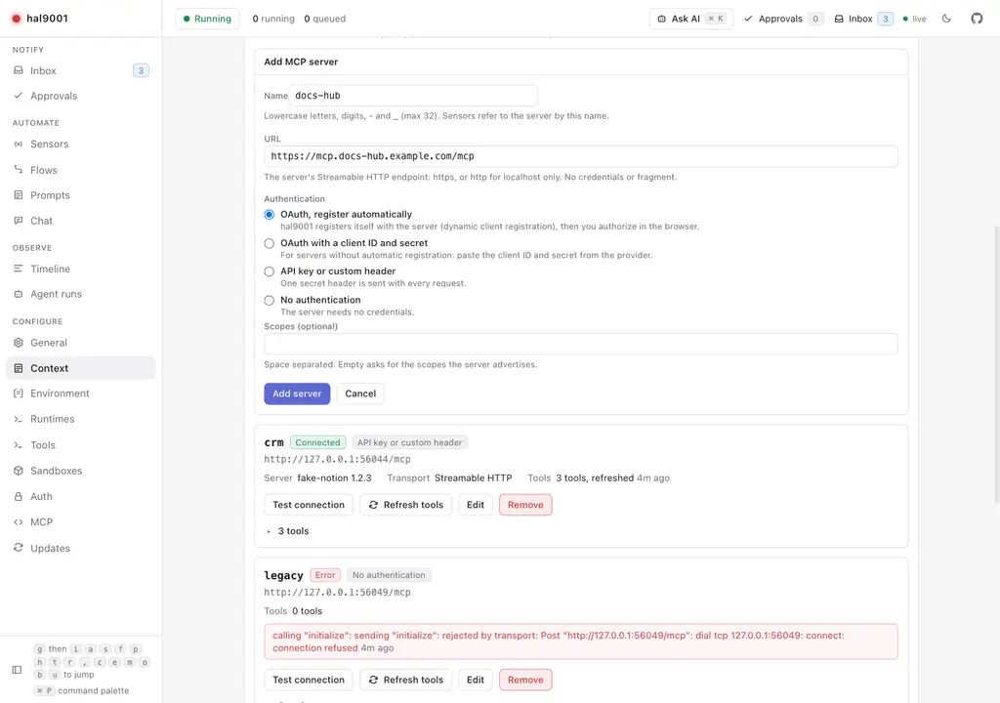
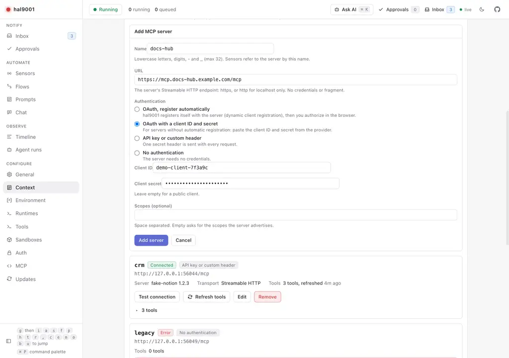
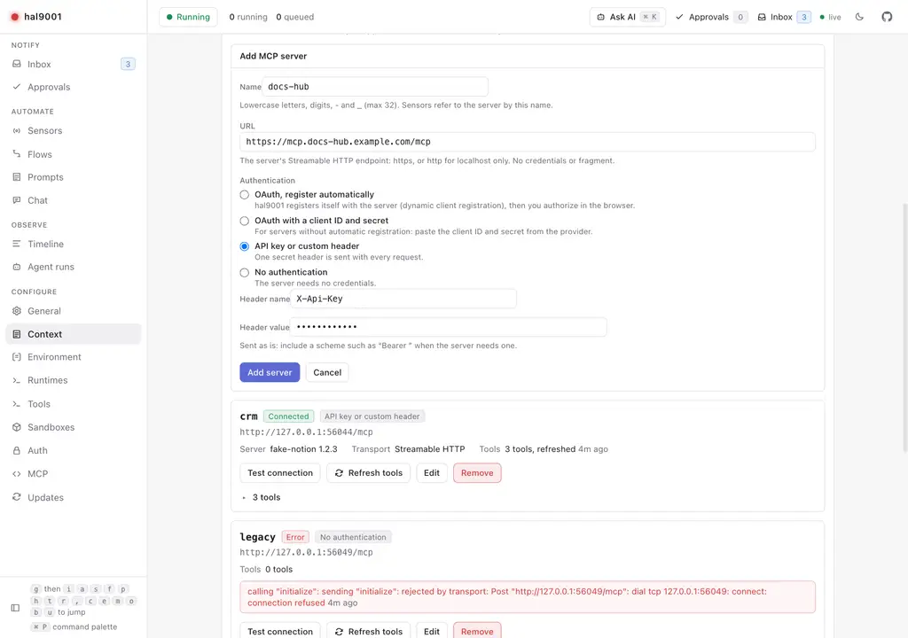
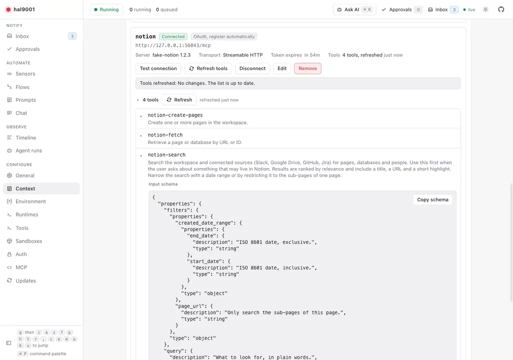
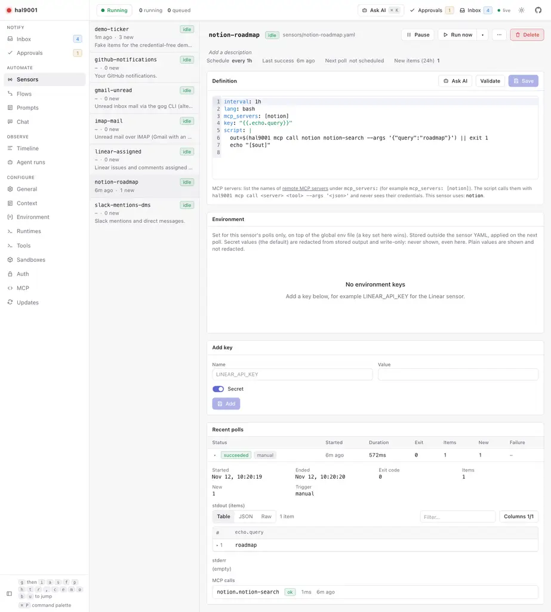
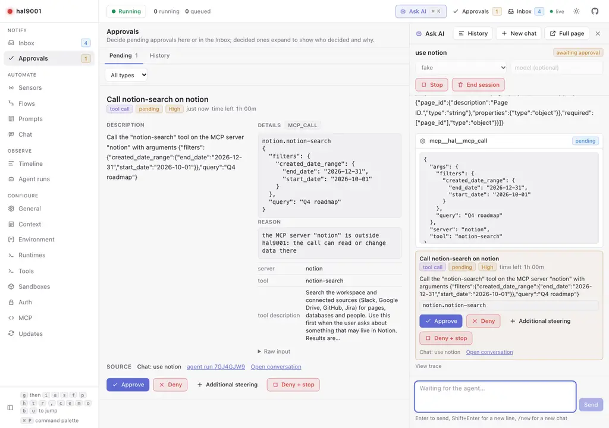

# Remote MCP servers (hal9001 as an MCP client)

hal9001 can connect to remote MCP servers such as Notion or Linear. You add a server once, sign in once, and then two
things can use its tools:

- **Sensors** call tools from their script with `hal9001 mcp call`. No approval is needed at poll time, because you
  approved the script itself.
- **The chat assistant** lists, inspects and calls tools with `mcp_servers_list`, `mcp_server_inspect` and `mcp_call`.
  Every `mcp_call` waits for your approval.

Credentials stay in the daemon. A sensor script and the assistant never see a token or an API key.

## How this differs from the other MCP pages

| | Direction | Page |
|---|---|---|
| hal9001 **as a server** for Claude Code, Codex, omp and pi | Their clients call hal9001. | [mcp.md](mcp.md) |
| MCP servers an **agent node** passes through to its agent session | The agent in a flow talks to that server itself, with the node's `allow.tools` policy. | [flows.md](flows.md#mcp-servers) |
| **Remote MCP servers** (this page) | hal9001 is the client. Sensors and the chat assistant call tools through it. | this page |

The three are independent. A server you add here is not passed to agent nodes, and `mcp_servers` on an agent node does not
create a server here. The sensor field `mcp_servers` (a list of names from this page) is also unrelated to the agent node
field of the same name.

## Add a server

Open **Settings → Context → MCP servers** and choose **Add MCP server**.

 ([dark](images/mcp-servers/servers-list-dark.png))

Fields:

- **Name**: lowercase letters, digits, `-` and `_`, at most 32 characters, starting with a letter or digit. Sensors refer
  to the server by this name. It cannot be changed later; remove the server and add it again.
- **URL**: the server's Streamable HTTP endpoint. `https`, or `http` for a loopback host only. No credentials and no
  fragment in the URL.
- **Authentication**, one of four modes:

| Mode | `auth:` value | Use when |
|---|---|---|
| OAuth, register automatically (default) | `oauth` | The server supports OAuth with dynamic client registration (RFC 7591). Most hosted MCP servers do. |
| OAuth with a client ID and secret | `oauth_client` | The provider has no dynamic registration. You create an OAuth app there and paste its client ID and secret. The secret is optional for a public client. |
| API key or custom header | `header` | The server takes a key in a header. You give the header name (for example `Authorization` or `X-Api-Key`) and the value. The value is sent as is: include a scheme such as `Bearer ` when the server needs one. |
| No authentication | `none` | The server needs no credentials. |

OAuth modes also take optional **Scopes** (space separated). Empty asks for the scopes the server advertises.

 ([dark](images/mcp-servers/add-server-oauth-dark.png))

 ([dark](images/mcp-servers/add-server-client-dark.png))

 ([dark](images/mcp-servers/add-server-apikey-dark.png))

The secret fields (client secret, API key) are write-only. Leaving one blank when you edit a server keeps the stored value.
**Remove stored value** deletes it. Changing the URL, the auth mode or the client ID of an OAuth server discards its stored
tokens, because they were issued for the old combination. You then connect again.

### config.yaml

Servers are defined under `mcp_servers` in `config.yaml`. Only non-secret fields live there. The UI edits this block and
keeps your comments and order.

```yaml
mcp_servers:
  notion:
    url: https://mcp.notion.com/mcp          # auth defaults to oauth
  linear-keyed:
    url: https://mcp.example.com/mcp
    auth: header
    header: Authorization                    # the value is stored separately, never here
  crm:
    url: https://mcp.crm.example.com/mcp
    auth: oauth_client
    client_id: hal9001-local                 # not a secret; the client secret is stored separately
    scopes: [read, offline_access]
  local-dev:
    url: http://127.0.0.1:8808/mcp
    auth: none
```

Fields: `url` (required), `auth` (`oauth` when omitted), `client_id` (`oauth_client` only), `header` (`header` only), `scopes`
(OAuth modes only). `hal9001 validate` and the daemon reject anything else.

### Where secrets live

Client secrets, API keys, OAuth registrations and tokens are stored in `<home>/data/mcp/<name>.secrets.json`. The directory
is `0700` and the file `0600`. No API returns these values (the API only says whether a secret is stored), and they are
never written to `config.yaml`, the database, logs or Inbox notes. What hal9001 learned about the server (tool cache, last
error, server name and version, transport) is in `<home>/data/mcp/<name>.state.json`, which holds no secret.

## Connect with OAuth

For an OAuth server, choose **Connect**. hal9001 prepares the authorization, shows a link and opens it in a new browser
tab. Approve there. The provider sends the browser back to hal9001, which stores the tokens, caches the tool list and
returns you to the server's card.

**You must complete this in a browser on the Mac that runs hal9001.** The redirect URI is
`http://127.0.0.1:<port>/oauth/callback`, with the port the daemon really listens on, and a loopback address only reaches
the machine the browser runs on. Opening the Settings page from another device (for example over Tailscale) and approving
there does not work.

What hal9001 does, following the MCP authorization specification:

1. **Probe.** It sends an unauthenticated request to the server URL. A `401` with a `WWW-Authenticate: Bearer` challenge
   carries a `resource_metadata` URL and may carry a `scope`. A server that answers without asking for credentials is
   reported as not needing OAuth.
2. **Resource metadata (RFC 9728).** It reads the protected resource metadata from the challenge URL, then from the
   well-known locations under the server's path and root, to find the authorization server and the `resource`
   identifier. Without metadata, the server's origin is treated as the authorization server (earlier specification
   revisions).
3. **Authorization server metadata.** RFC 8414 or OpenID Connect discovery. hal9001 refuses a server that lists PKCE
   methods without `S256`.
4. **Client.** `oauth`: dynamic client registration (RFC 7591) as a native client with the loopback redirect URI. The
   registration is stored and reused while the authorization server and the redirect URI stay the same. A server without a
   registration endpoint fails with a message that tells you to use the client ID and secret mode. `oauth_client`: your
   pasted client is used as is.
5. **Authorization code flow with PKCE (S256)** and the `resource` parameter (RFC 8707) on the authorization and token
   requests. The `state` is random, bound to one server, valid for 10 minutes and usable once. Starting Connect again
   replaces the pending authorization of that server.
6. **Scopes.** Your configured scopes, else the challenge's, else the resource's advertised scopes. `offline_access` is
   added when the authorization server offers it, so that a refresh token is issued.
7. **Issuer check.** When the response carries `iss` (RFC 9207), it must match the authorization server.

The callback `GET /oauth/callback` is public: the browser may hold no hal9001 session for `127.0.0.1`, and the credential is
the single-use `state`. An unknown, expired or reused state is refused and stores nothing.

Client ID Metadata Documents are not supported, because they need a public HTTPS URL and a loopback daemon has none.

### Tokens, refresh and reconnect

hal9001 refreshes the access token shortly before it expires, and once more when the server answers `401`. Refreshing is
done under a lock so that concurrent calls do not redeem the same refresh token twice.

- If the authorization server **refuses the refresh for good** (for example `invalid_grant`, or the server still answers
  `401` with the new token, or there is no refresh token), the status becomes **needs reconnect** and hal9001 posts one
  high-priority Inbox note with a **Reconnect** link. It posts the note once, until you reconnect.
- A **transient** failure (network, a 5xx) only shows status **error** with the message. Nothing is posted, and the next
  use tries again.

Press **Reconnect** on the card (or the link in the Inbox note) to authorize again. The button is named **Reconnect** when
the status is `needs_reconnect` or `error`, and **Connect** when it is `disconnected`.

## Status values

| Status | Meaning |
|---|---|
| `connected` | Credentials are in place and the last operation worked. For OAuth: a token is stored and not known to be bad. |
| `needs_reconnect` | OAuth credentials were rejected and refreshing failed. Connect again. |
| `disconnected` | No credentials yet: an OAuth server that is not connected, or a `header` server without a stored key. |
| `error` | The last operation failed for another reason (unreachable, protocol error, 5xx). The message and time are on the card. |
| `unknown` | Nothing has been tried yet (a `none` server, or a `header` server with a key, before first use). |

A successful operation clears `error`.

## Test, tools and changes

The card has these buttons: **Connect** or **Reconnect** (OAuth servers that are not connected), **Test connection**,
**Refresh tools**, **Disconnect** (OAuth, unless already disconnected), **Edit** and **Remove**.

- **Test connection** connects, initializes, lists the tools and reports server name and version, protocol version,
  transport, tool count and latency. It does not change the cached tool list.
- **Refresh tools** lists the tools again and caches them. The card shows each tool with its description and input
  schema, and what was added, changed or removed.

 ([dark](images/mcp-servers/server-card-tools-dark.png))

- **Change detection.** When a refresh finds a tool added, removed, or with a different title, description or schema, hal9001
  posts one low-priority informational Inbox note listing them, with a link to the card. The first refresh of a server
  posts no note, since there is nothing to compare with. Tools are refreshed when you connect and when you press the
  button; they are not polled in the background.
- **Disconnect** (OAuth only) deletes the stored token and registration. The server stays configured with status
  `disconnected`. A pasted client secret and the tool cache stay.
- **Remove** deletes the `config.yaml` entry and everything stored under `data/mcp/` for the server. It is refused while a
  sensor lists the server in `mcp_servers`: the error names the sensors.

### Transport

hal9001 connects with Streamable HTTP and falls back to the older HTTP+SSE transport when the Streamable HTTP connection
cannot be established. The card shows the transport the last successful connection used (`streamable_http` or `sse`). A
fallback is not tried after an authentication failure.

## Sensors

A sensor lists the servers it may call in `mcp_servers`:

```yaml
# sensors/notion-roadmap.yaml
id: notion-roadmap
interval: 15m
lang: bash
mcp_servers: [notion]
key: "{{.id}}:{{.last_edited}}"
timeout: 60s
script: |
  hal9001 mcp call notion notion-search --args '{"query": "roadmap"}' \
    | jq -c '.results[] | {id, title, last_edited}'
```

The tool name and the argument names above are examples. Take the real ones from the server's tool list on its card.

- **Validation.** Every name in `mcp_servers` must be a valid name of a server that exists in `config.yaml`, and none may
  repeat. `hal9001 validate`, the sensor editor and the API report an unknown server.
- **Environment.** When a sensor declares servers, the poll's environment gets `HAL9001_URL` (where the daemon is) and
  `HAL9001_RUN_TOKEN`. Assistant `draft_test` runs get the same for the draft's servers. `hal9001` is on the script's `PATH`
  even if you never installed the command-line tool.
- **The token grants exactly the declared servers.** A call to any other server is refused with `403` and nothing is sent
  to that server. The token is random, lives in daemon memory only, and is revoked when the poll ends. It is also removed
  after the sensor's timeout plus a minute at the latest.
- **The script never sees server credentials.** It holds only the run token. The daemon adds the OAuth token or API key
  when it calls the server.

 ([dark](images/mcp-servers/sensor-mcp-call-dark.png))

### `hal9001 mcp call`

```
hal9001 mcp call <server> <tool> [--args '<json object>']
```

- `--args` is a JSON object, default `{}`. `--args -` reads it from stdin, which avoids shell quoting for large or
  generated arguments.
- **Output.** The tool's `structuredContent` as one line of JSON when it has any, otherwise `{"text": "..."}` with the
  tool's text content joined by newlines.
- **A tool error** (the tool ran and reported a failure) exits `1` and prints the message on stderr. The poll then fails
  visibly.
- **A refused server** (not in `mcp_servers`) is `403`. A server that is not connected or needs reconnecting is a `409`
  with the reason. An unreachable server is `502`. These also exit non-zero.
- **No approval at poll time.** You approved the script when you saved it (or when the assistant's `draft_test` asked, see
  below). Treat adding a tool call to a sensor like adding any other network call.
- **Every call is logged.** The sensor run records each call as an entry of `mcp_calls` (server, tool, time, duration, ok,
  error), shown on the run in the Sensors page and returned by the sensor runs API. Arguments and results are not
  recorded.

`hal9001 mcp` with no further arguments is still the stdio bridge to hal9001's own MCP server ([mcp.md](mcp.md)). Only
`hal9001 mcp call` is the client command.

## The chat assistant

When the daemon has an MCP client, the assistant gets three tools:

| Tool | What it does | Approval |
|---|---|---|
| `mcp_servers_list` | Lists the configured servers with status, auth mode and tool count. | never |
| `mcp_server_inspect` | One server with every tool, its description and input and output schemas. Refreshes the tool list first when it was never fetched. | never |
| `mcp_call` | Calls one tool with arguments. | **always** |

- **`mcp_call` always asks.** The approval card shows the server, the tool, the tool's description and the arguments.
  There is no "always allow".

 ([dark](images/mcp-servers/mcp-call-approval-dark.png))

- **A call that cannot work is refused before asking:** an unknown server, a `disconnected` server or one that
  `needs_reconnect`. The assistant gets the reason and tells you to connect the server in Settings → Context.
- **A denial comes back as a tool error.** Your comment is the steering text, and the assistant should not repeat the
  call.
- **Results** are the tool's structured content when it has any, else its text. They are redacted and shortened like other
  read tool results. A tool that reports an error is returned to the assistant as an error.
- **Sensor drafts.** In a sensor draft session the assistant is told to inspect the server first, optionally try the call
  (with your approval), then write a script that uses `hal9001 mcp call` and put the server in `mcp_servers`. `draft_test`
  runs with a run token for the declared servers, so calls inside the test need no extra approval.
- **`draft_test` approval.** When the script changed, the existing `tool_call` approval for `draft_test` gets an `mcp`
  fact that lists the servers the sensor declares and the `server.tool` pairs the script calls (found with a text match on
  `hal9001 mcp call <server> <tool>`; a server or tool built from a shell variable is not listed). A script that gains a
  server or a call needs approval again. See [assist.md](assist.md#tools-and-permissions).

## API

All routes are in `api/openapi.yaml` under the `mcp-servers` tag.

| Route | Auth | Purpose |
|---|---|---|
| `GET /api/mcp-servers` | `api` | List servers with status and tool count. |
| `POST /api/mcp-servers` | `admin` | Add a server (body: `name`, `url`, `auth`, `client_id`, `client_secret`, `header`, `api_key`, `scopes`). `409` if the name exists. |
| `GET /api/mcp-servers/{name}` | `api` | One server with its cached tools. |
| `PUT /api/mcp-servers/{name}` | `admin` | Change a server. Secrets are write-only; omit one to keep it. |
| `DELETE /api/mcp-servers/{name}` | `admin` | Remove it. `409` while a sensor uses it. |
| `POST /api/mcp-servers/{name}/connect` | `admin` | Returns `authorize_url` and `expires_at` to open in a browser. |
| `POST /api/mcp-servers/{name}/disconnect` | `admin` | Drop the OAuth token. |
| `POST /api/mcp-servers/{name}/test` | `admin` | Test the connection. |
| `POST /api/mcp-servers/{name}/tools/refresh` | `admin` | Refresh the tool list; returns the server and the `changes`. |
| `POST /api/mcp-servers/{name}/call` | run token, else `admin` | Body `{tool, arguments}`. Returns `{is_error, text, structured_content?}`. A run token grants only its sensor's servers. |
| `GET /oauth/callback` | public (the `state` is the credential) | OAuth redirect target; redirects to `/settings/context?mcp_server=<name>`. |

Changes also publish an `mcp_server.updated` event on the event stream. The CLI equivalent of the call route is
`hal9001 mcp call`. See [api.md](api.md) for the auth services.

## Security notes

- Credentials live only in `data/mcp/<name>.secrets.json` (`0600`). They are not in `config.yaml`, any API response, logs or
  Inbox notes.
- Run tokens exist in daemon memory only, grant exactly the servers a sensor declares, and are revoked when the poll
  ends. A daemon restart ends every run, so no token survives it.
- Agent calls are always approved: `mcp_call` has no allowlist and no remembered approval.
- **A server is trusted once you add it.** There is no per-tool trust: a sensor that declares a server can call any of its
  tools, including ones that change data. Add only servers you trust, and prefer an account or API key with limited access.
- **An admin API caller can call tools without approval.** `POST /api/mcp-servers/{name}/call` is an `admin` endpoint like
  the rest of the admin API. With the default `localhost-trust`, any local process (for example `curl`) can call tools of
  every connected server. The remark in [mcp.md](mcp.md) that approvals are no boundary against local processes applies
  here too.
- **Treat tool output as untrusted data.** It can contain text written by other people, including instructions aimed at an
  LLM. Parse it with `jq` or a program, never run it, and do not pass it unchecked to an agent that can act.
- The OAuth callback accepts only a live `state`, uses it once, and answers with `Cache-Control: no-store` and
  `Referrer-Policy: no-referrer`.
- Client ID Metadata Documents are not supported (see above).

## Limits

- hal9001 uses **tools** only. It does not use a server's resources, prompts, sampling or elicitation.
- Each call opens a new connection to the server and closes it after the call. There is no long-lived session.
- Connect, Test and Refresh tools time out after 45 seconds. A tool call times out after 5 minutes.
- A server can be listed with at most 100 pages of tools.
- A server name cannot be changed. Changing the URL, auth mode or client ID of an OAuth server drops its tokens.
- Connecting needs a browser on the Mac that runs hal9001 (see above).
- Servers are not available to agent nodes through this page. Use the node's own `mcp_servers` ([flows.md](flows.md#mcp-servers)).
- The tool cache is refreshed on connect and on request only. A server that changes its tools is noticed at the next
  refresh.

## Notion

Notion hosts an MCP server. **Everything in this section comes from Notion's developer documentation and is unverified
against a live account.** This feature was built and tested against scripted fake servers, never against Notion itself. Use
the checklist below to confirm it.

What Notion documents ([Build an MCP client](https://developers.notion.com/guides/mcp/build-mcp-client)):

- Server URL: `https://mcp.notion.com/mcp` (Streamable HTTP). `https://mcp.notion.com/sse` is the SSE fallback.
  hal9001 tries Streamable HTTP first and falls back to SSE by itself, so add the first URL.
- Authentication: OAuth 2.0 authorization code flow with PKCE and dynamic client registration. That is the default mode,
  `oauth`, so no client ID or secret is needed.
- A workspace owner may need to approve the client before a member can connect.

### Checklist

Do these on the Mac that runs hal9001, with a Notion account you can test with. Note anything that differs.

1. Settings → Context → MCP servers → **Add MCP server**. Name `notion`, URL `https://mcp.notion.com/mcp`, authentication
   **OAuth, register automatically**. Save.
2. Press **Connect**. A browser tab opens at Notion. Sign in, pick the workspace and approve. If Notion asks for an owner's
   approval, ask the owner.
3. You are returned to the card and the status is **connected**. If the status is `error`, read the message on the card.
4. Press **Refresh tools**. Read the tool names, descriptions and input schemas. Write down the name of a search tool and
   its argument names. They are not assumed anywhere in hal9001.
5. Press **Test connection**. Expect `ok`, a server name and version, the transport (`streamable_http`) and a tool count.
6. Add a sensor with `mcp_servers: [notion]` and a script that calls the search tool, replacing the tool and argument
   names with the ones from step 4:

   ```bash
   hal9001 mcp call notion <search tool> --args '{"<query argument>": "roadmap"}' | jq -c '.'
   ```

   The output is the tool's `structuredContent`, or `{"text": "..."}` if the tool returns only text. Adjust the `jq`
   filter and `key` to the real shape.
7. Press **Run now** on the sensor and open the run. The run shows an `mcp_calls` entry for `notion` and the tool, with `ok`
   and a duration.
8. In the chat assistant ask: "Inspect the notion MCP server, then call its search tool for 'roadmap'." Check that the
   approval card shows server, tool, description and arguments, then **Approve** and read the result.
9. Ask for another call and **Deny** it with a comment. The assistant must report the denial and follow the comment without
   repeating the call.
10. Press **Disconnect**: the status becomes `disconnected`. Press **Connect** and approve again: `connected`.
11. In Notion, revoke the hal9001 connection in your account's connection settings. Press **Test connection** or **Run
    now** on the sensor. Expect status **needs reconnect** and one high-priority Inbox note with a **Reconnect** link.
    Reconnect from the link and check the status is `connected` again.
